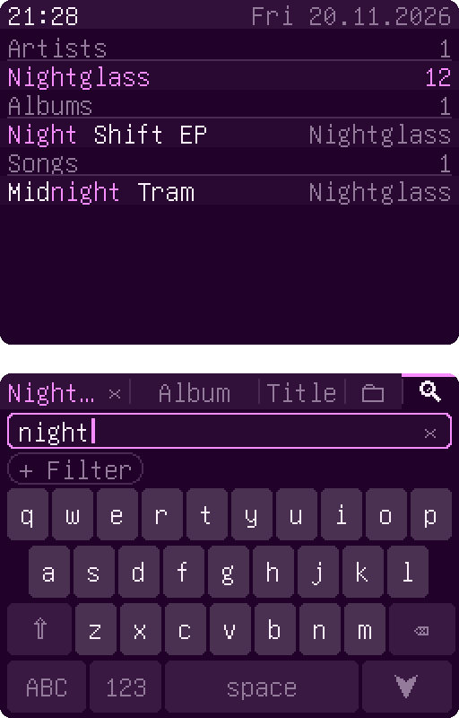
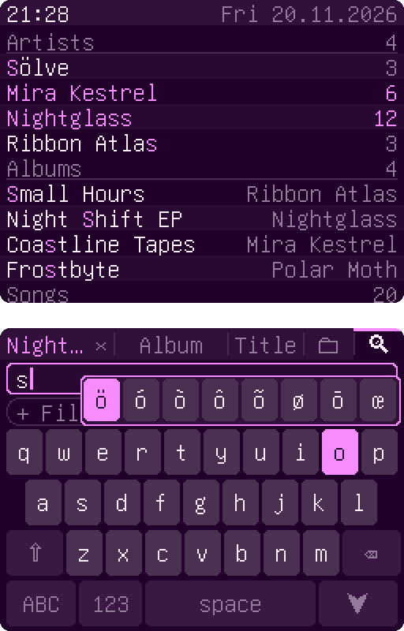
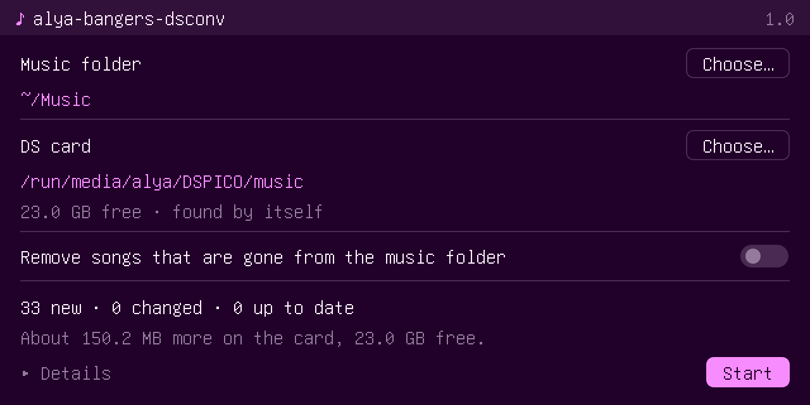
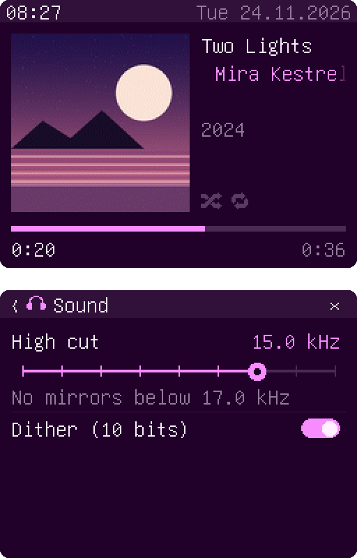

# alya-bangers
Music player for the Nintendo DS, requires a flashcart. :-)

Version pre-1.0, DS Edition. 1.0 is in the making.

> [!NOTE]
> There's no release yet. With 1.0 the `.nds` and the converter will be in the [releases](../../releases).
>
> There are pre-release builds in [GitHub Actions](../../actions/workflows/release.yml): open the newest run, the files are at the bottom under *Artifacts* (`nds`, `converter-Windows`, `converter-Linux`). Downloading them needs a GitHub account, and they're kept for 90 days. They are less tested than a release.
> If you want to build it yourself (see [Building](#building)).

<table>
<tr>
<td></td>
<td></td>
<td></td>
</tr>
</table>

Your music gets put on the card from the PC with [alya-bangers-dsconv](#converter), which is in this repo too (`alya-bangers-dsconv/`). Everything else is the DS program.

---

> [!WARNING]
> I just wanted to listen to my music on my DS on a player I like (and looks really cool lol), so I vibecoded it... Expect a huge part of this repo to be AI generated/asssited. Like I said, I just want to enjoy my music. :-)

---

> [!NOTE]
> All pictures here are the app itself, taken by its screen test with a made-up library. The artists and songs don't exist.

## Features:
- Browse by artist, album, title or folder
- Search in any script (ABC, かな, 拼音, АБВ)
- Player with a turning record and a visualizer
- Queue you can edit
- 3-band equalizer with your own profiles
- High cut and dither for cleaner highs
- Ratings and plays
- Themes with your own colours
- English and German
- A converter with a window for Windows and Linux

## Browsing:


- Tabs: Artist · Album · Title · Folder · 🔍
  - Picking an artist opens their albums, picking an album its songs.
  - The tabs then show what you picked. Tap the name to go back to that list, the small × clears it.
  - Lists slide sideways when you switch tabs or open something, and the highlight glides from row to row.
- Tapping a song plays the list it's in.
- Bottom bar: play/pause, next, add to queue, ⮟ (player), sort, brightness (4 levels), ⋮ settings
- Adding to the queue:
  - Hold a row for *Play now / Play next / Add to queue*
  - Or turn on the add-to-queue button. Tapping rows then adds them. (An artist or album adds all of its songs.)
- Artists that only differ in case ("KIVARA", "Kivara") are one artist. You can change that in the settings.
- Several artists (several values in the artist tag, like Quod Libet writes them):
  - Shown together, and the song is listed under each of them.
  - In the player every name opens its own artist.
  - Names joined inside one value ("A x B") stay one artist.
- Names are drawn with the `font.bin` the converter writes, so Japanese, Chinese, Cyrillic, Vietnamese and even emoji show up correctly.

<br clear="right">

## Player:


- ⮟ in the bar: the browser slides down until only the tabs are left.
  - Seek bar (drag it), shuffle, previous, play/pause, next, repeat (off, all, one), ⓘ song info, ☰ queue, ⮝ back to browsing
- Top screen:
  - The cover on its record, turning at 33⅓ rpm
  - Visualizer, the next song, time and date
  - The background is the cover, blurred and darkened. It's made one slice per frame and fades in once the covers settle. A very dark cover gets a lighter background so it doesn't melt into it.
- When the song changes:
  - The cover slides off over its record, the next one grows out of the Next spot and its record rolls out. Going back plays it backwards.
  - In browse mode the covers behave like a stack, in list order.
  - The texts fade and scroll from their start for every song.
- Paused: the record spins down and the bars of the visualizer fall.
- Tap the artist at the start of the top line for their albums.
- Songs without a cover get a built-in picture: the moonlit beach.

<br clear="right">

<table>
<tr>
<td></td>
<td></td>
</tr>
<tr>
<td align="center">ⓘ song info: rate it</td>
<td align="center">☰ the queue</td>
</tr>
<tr>
<td></td>
<td></td>
</tr>
<tr>
<td align="center">the equalizer, Treble being dragged</td>
<td align="center">two artists, each tappable</td>
</tr>
</table>

- Rating and plays (ⓘ):
  - Tap a star to give the song that many. Tap the last lit one again for none. Left / Right work too.
  - A song counts as played after half of it or 4 minutes of listening, once per listen.
  - Your rating from the DS wins over the one in the file's tags. Plays add up.
  - Saved in `/_nds/alya-bangers/stats.bin`.
- Queue (☰): tap a song to jump to it, × removes it, hold and drag to move it.
- Equalizer (the slider button next to ⓘ, lit while it changes the sound):
  - 3 bands, each −12 to +12 dB: Bass (shelf at 120 Hz), Mid (peak at 1 kHz), Treble (shelf at 5 kHz)
  - Drag a slider or tap where it should go. You hear it within half a second.
  - Tap a profile to use it. *Flat* is always on top and changes nothing.
  - Save: on one of your profiles it saves over it, on Flat it asks for a name (the search keyboard). Up to 7 profiles.
  - Hold a profile and drag it to move it. Delete asks first.
  - Boosting turns everything down by the same amount first, so nothing clips.
  - Saved in `/_nds/alya-bangers/eq.bin`, the chosen one in `state.bin`.
- Shuffle by rating (Settings › Player):
  - Every star doubles the chance of a song coming next (unrated counts as 3 stars). So 5 stars come up 4× as often as unrated ones.
  - A short queue still plays every song once per round, the good ones just come earlier.
- Lid closed: the screens fade to dark and the music keeps playing. L/R change songs. (Both can be changed in the settings.)
- Switching on loads the last song at the same position, paused. With *Play on launch* it keeps playing.

## Search:


- Type on the bottom screen. The results show up on the top screen while you type: artists, albums and songs, the matching part highlighted.
  - D-pad Up/Down and A pick one.
- ⮟ (or B) puts the keyboard away and the results slide down into a list:
  - Tap a song to play the results from there
  - Hold one for the row menu
  - Tap an artist or album to open it
  - Tap the query to type again, × clears it
- Matching:
  - Case and accents don't matter ("solve" finds Sölve), unless you type the accent ("sö" means exactly ö).
  - Hiragana finds katakana.
  - Names with kanji or hanzi are found by their readings (the converter adds them): kana with かな, pinyin with 拼音 ("lin" or "linxingyue" for 林星月).

<br clear="right">

<table>
<tr>
<td></td>
<td></td>
<td></td>
</tr>
<tr>
<td align="center">hold a letter for its other forms</td>
<td align="center">かな: はな finds ハナビラ</td>
<td align="center">拼音: lin finds 林星月</td>
</tr>
<tr>
<td></td>
<td></td>
<td></td>
</tr>
<tr>
<td align="center">АБВ (ЙЦУКЕН)</td>
<td align="center">+ Filter: a genre</td>
<td align="center">the filter as a chip, songs as a list</td>
</tr>
</table>

- Keyboards: ABC (QWERTY, or QWERTZ in Settings › Regional), かな, 拼音, АБВ and 123
  - かな is the 50-sound table. ゛ ゜ and 小 change the last kana.
  - Tap the input key for the next keyboard (the new keys push the old ones out), hold it for the list.
  - Hold a letter for its other forms (ä à á â …, е gives ё), slide onto one and let go.
- \+ Filter:
  - Search in (all, only artists, only albums, only songs), genre, rating, year (decades), played (never, at least once, 10 times or more), folder
  - Every option shows how many songs it has.
  - A filter becomes a chip, × removes it.
  - With a filter on, the results are songs, and what you type also looks at their artists and albums.

## Settings and themes:


- Settings (⋮): the pages slide in from the right. ‹, B or Left go back, A or Right open one.
- Every page has an icon, so you can find the language without being able to read it: the globe (🌐) leads to Regional, then Language.
- Pages:
  - Playback: ReplayGain, play on launch, pause when the lid closes, L/R skip with the lid closed
  - Sound: for the harsh sound very high parts (cymbals, hi-hats) can get on the DS. Both off by default, try what helps with your headphones.
    - High cut: a steep filter on the very highs. The slider's right end is off, the further left the lower it cuts (15.5 down to 12.0 kHz). The line under it says below what nothing gets mirrored.
    - Dither (10 bits): the DS's rounding becomes a quiet hiss instead of a harsh edge.
    - How both work is under [How playback works](#how-playback-works).
  - Browsing: case-sensitive names, scroll all long rows
  - Player: time on the right (length or time left), cover background, shuffle by rating
  - Theme:
    - The app's three colours (accent, background, text) on a colour triangle. The ring picks the hue, the triangle how strong and bright it is.
    - Every other colour is mixed from these three, and the whole app changes while you drag.
    - Up / Down choose the colour, Left / Right turn its hue.
    - Presets (A): *Ultraviolet* (the default) and *Midnight Rose* (the first theme). They always show in their own fixed colours, so you can get back even if you made your theme unreadable xD
  - Regional: the language (English or German, the German in Swiss spelling) and the search keyboard (QWERTY or QWERTZ)
  - About: name, version and edition, licence, where the code lives

<br clear="right">

<table>
<tr>
<td></td>
<td></td>
<td></td>
</tr>
<tr>
<td align="center">settings</td>
<td align="center">theme presets</td>
<td align="center">auf Deutsch</td>
</tr>
</table>

## Buttons:

| Button | Browsing | Player |
|---|---|---|
| Up / Down | move (faster when held) | |
| Left / Right | tab to the left / right | −10 s / +10 s |
| A | open / play | play / pause |
| B | the player (search: keyboard away) | back to browsing |
| X | add-to-queue mode | song info |
| Y | row menu | queue |
| SELECT | player | back to browsing |
| START | play / pause | play / pause |
| L / R | previous / next song (L restarts the song after 3 s) | same |

- In menus: Up/Down, A chooses, B closes.
- In the equalizer: X switches between the profiles (Up/Down) and the sliders (Left/Right: which one, Up/Down: 1 dB). A saves, Y deletes, B closes.
- On the high cut's slider (Settings › Sound): Left/Right move it, B goes back.
- Menus slide up when they open and down when they close, buttons light up when tapped, and play and pause morph into each other.

> [!NOTE]
> If the SD card is ever too slow, a red "drops: N" shows up at the top. If you see that on a real DS, please open an issue!

## Converter:

<table>
<tr>
<td></td>
<td></td>
</tr>
</table>

alya-bangers-dsconv puts your music on the card. Same colours and font as on the DS :-)

- Get it from the [releases](../../releases) (or a pre-release build from [GitHub Actions](../../actions/workflows/release.yml)): the `.exe` for Windows, the `.AppImage` for Linux. Then double-click it.
  - Windows: the first time "Windows protected your PC" shows up, because the file isn't signed. *More info*, then *Run anyway*.
  - Linux: allow executing it first (in the file's properties, or `chmod +x`).
  - NixOS: AppImages don't run as they are there. The flake is easier: `nix run github:alya-can-eat/alya-bangers?dir=alya-bangers-dsconv`, or `nix profile install` it for an entry in the app launcher.
- Choose your music folder and the DS card. A card that already has music from it is found by itself.
- Convert first checks what's new and whether it fits on the card, then Start.
  - Next time only new and changed songs get converted.
- Two files that would become the same song (like a FLAC and an Opus of it): it asks which one goes on the card and suggests the better one. The answer is remembered.
- *Remove songs that are gone from the music folder*: also deletes the songs on the card you don't have anymore.
- Stop finishes the songs in progress. Next time it goes on from there.
- English or German, like the computer.
- It also works on the command line, more in [alya-bangers-dsconv](alya-bangers-dsconv/).

## SD card:

```
/music/                      <- what the converter writes
/music/.dsmusic/font.bin
/music/.dsmusic/library.idx
/_nds/alya-bangers/state.bin <- written by the player
/_nds/alya-bangers/stats.bin <- ratings and plays from the DS
/_nds/alya-bangers/eq.bin    <- your equalizer profiles
/alya-bangers.nds            <- anywhere, start it from Pico Launcher
```

Put your music on it with the [converter](#converter), or on the command line:

```sh
alya-bangers-dsconv ~/Music /run/media/alya/DSPICO/music
```

## Building:

With the official BlocksDS container. You need Podman or Docker for it.

> [!TIP]
> On NixOS add `virtualisation.podman.enable = true;` to your configuration.

```sh
./build.sh
```

This makes `alya-bangers.nds`. The first run downloads the image, which is about 430 MB.

GitHub Actions builds it the same way for the releases (see [Releasing](#releasing)).

## Testing in melonDS:

You can try it in melonDS before using the real card. melonDS is in nixpkgs (`nix-shell -p melonDS`).

1. Convert some music into a test folder: choose `/tmp/dscard` as the card in the converter, or `alya-bangers-dsconv ~/Music/some-album /tmp/dscard/music`
2. In melonDS's emulator settings (DLDI section): enable DLDI, set the folder to sync the SD image with to `/tmp/dscard` and turn that sync on.
3. *File → Open ROM*: `alya-bangers.nds`

> [!WARNING]
> An emulator is not a real DS! Timing and SD speed are different, so the final test always has to be on the DS Lite.

## How playback works:

Technical stuff, in case you're curious :-D

- The ARM9 reads the card, the ARM7 drives the sound hardware. (The messages between them are in `common/include/ipc.h`.)
- Two hardware channels (left panned left, right panned right) loop over a ring of 8 blocks each (1 s).
  - The channel timer is `0x10000 - 512`, so they play at 16756991 / 512 = 32728.5 Hz. That's exactly the DS mixer's rate.
- An ARM7 timer with the /1024 prescaler ticks once per sample (same crystal, 33513982 / 1024 Hz) and interrupts after every 4096 samples. The ARM9 then loads the next block into the slot that just finished.
  - A `.dsa` block holds all left samples, then all right samples, so each half is read straight from the card into its ring.
- Playback comes before drawing:
  - While 3 or more blocks are ready ahead, the ARM9 reads one block per call (twice per frame), so the reading is spread out.
  - When fewer are ready, it reads everything that's missing at once.
  - The ARM7 (and with it the sound hardware) has priority on main RAM, so copying whole screens can't make the sound wait.
- Seek restarts the stream at a block boundary (0.125 s steps).
- Pause and resume fade (15 ms each), so they don't click:
  - Pause: the ARM7 turns the channels' volume down step by step, counting samples on the same timer, then stops and reports the exact sample.
  - Resume: the stream starts at that block's beginning, silent up to that sample, and fades in from there. Nothing is heard twice.
- Equalizer:
  - Runs on the samples in the ring, in place, at most 4 blocks (0.5 s) ahead of the one playing. The reading stays up to 8 blocks ahead, so a change is heard within half a second without reading anything again.
  - Biquads (RBJ Audio EQ Cookbook) with 32-bit coefficients from `arm9/source/eq_tables.h`, samples carried with 12 extra bits, 64-bit sums.
  - The inner loop runs from ITCM in ARM mode, on a buffer in DTCM. Bands at 0 dB are skipped, so Flat costs nothing. All 3 bands take about 12 % of the ARM9 (counted from the compiled loop, not measured on the DS yet).
  - The loudest point of the curve (+0.25 dB) is worked out when a slider moves, and the input is turned down by that much.



- High cut and dither (Settings › Sound):
  - The DS plays 10 bits (PWM at 32.768 kHz, see GBATEK). The hardware just cuts off the lower 6 bits and holds every sample until the next one.
  - Holding mirrors very high sounds to 32.7 kHz minus their frequency (15 kHz also shows up at 17.7 kHz). The cut adds distortion that folds back down as tones that aren't in the music. That's the harsh sound on cymbals.
  - High cut: a 4th-order elliptic low-pass (0.1 dB ripple, at least 40 dB down), two more biquads after the bands. Its edge goes from 12.0 to 15.5 kHz in 0.5 kHz steps. What's left above the edge only mirrors above 16.8 to 18.7 kHz (the line under the slider).
  - While the high cut is on, the input is turned down 1 dB. Steep filters overshoot a bit, on loud masters about +1 dB.
  - Dither: TPDF dither and 3rd-order noise shaping round to 10 bits before the hardware does, so its cut changes nothing. The error becomes an even hiss, pushed away from around 3.5 kHz (where hearing is most sensitive) to the top.
  - On a very quiet 12 kHz tone the distortion that folds back drops from −33 dB to −54 dB with dither (`test_eq`).
  - They run in the same pass as the equalizer. High cut about 7 %, dither about 2 % of the ARM9 (counted, not measured on the DS yet). Off costs nothing.

<br clear="right">

### stats.bin:

- 16-byte header: `ABST`, version 1, header size, record count, record size
- 24-byte records, sorted by key:
  - key: FNV-1a 64 of the song's path below `/music`
  - plays
  - Unix time of the last play
  - rating: 0 = none, 1 to 5 stars, 6 = rated with no stars
- Then a check value: CRC-32 of the header XOR CRC-32 of the records.
- It's written to `stats.new` first and then renamed, so a save that gets cut short never loses the old one.

## Tests on the PC:

`tests/host` compiles the ARM9 code for the PC against a mock libnds and a simulated ARM7 that "plays" the ring buffers.

```sh
python3 tests/card/make_test_card.py /tmp/testcard   # the test library, made up
cd tests/host
make test_player && ./test_player "/tmp/testcard/card/music/CD/Track 01.dsa"   # checks the audio sample by sample
make test_eq && ./test_eq   # the equalizer, high cut and dither against exact references, curves, no clipping
make screens-run CARD=/tmp/testcard/card/music   # clicks through the UI, checks it, screenshots in shots/
```

- The screen test expects exactly this made-up library (its artists, albums and counts).
- `make_test_card.py` needs ffmpeg and the converter's Python dependencies.
- The converter's own tests: `cd alya-bangers-dsconv && nix develop -c pytest` (the window's tests run offscreen).
- The tests need a gcc that can build 32-bit programs (`-m32`), e.g. `nix-shell -p gcc_multi`.
- The screen test also draws every screen in German and checks that every text exists in both languages and fits its place. All texts of the interface are in `arm9/source/i18n.c` (English and German side by side).

### Generated stuff:

- README pictures: `tests/demo/make_demo_card.py` builds the made-up library, the screen test's demo mode (`./screens CARD out demo`) shoots the screens and films, and `tools/gen_readme_images.py` turns them into `docs/img/`. (The three commands are in the script.)
- `tools/gen_builtin_font.py`: the built-in glyphs (ASCII, UI symbols, icons, the umlauts and the keyboards' letters) from the converter's copy of Unifont
- `tools/gen_fold_tables.py`: the tables search uses to ignore accents
- `tools/gen_eq_tables.py`: the equalizer's filters for every gain, the high cut's filters and the noise shaping (needs scipy, e.g. `nix-shell -p python3Packages.scipy`)
- `tools/gen_default_cover.py`: the picture for songs without a cover
- `tools/gen_icon.py`: the icon of the `.nds` file
- `alya-bangers-dsconv/tools/build_app_icon.py`: the converter's icon, the same picture
- `alya-bangers-dsconv/tools/build_window_font.py`: the converter's font, Unifont as squares (needs fontTools)
- `alya-bangers-dsconv/tools/window_pictures.py`: the converter's pictures here

## Releasing:

1. Change the version (e.g. `pre-1.0` and `1.0.0.dev0` both become `1.0`) in:
   - `arm9/source/app.h` (`APP_VERSION`, shown on the About page)
   - `alya-bangers-dsconv/src/alya_bangers_dsconv/constants.py`, `alya-bangers-dsconv/pyproject.toml` and `alya-bangers-dsconv/flake.nix` (the converter's window and file names)
   - the top of this README
2. Commit that and push a tag with the same version: `git tag v1.0 && git push origin v1.0`
3. `.github/workflows/release.yml` then builds:
   - `alya-bangers.nds`, with `./build.sh` in the BlocksDS container
   - the converter's `.exe` and AppImage with `alya-bangers-dsconv/packaging/build.py`, which also tries both (converts a song, opens the window)
   - and puts all three into a draft release.
4. Try that `.nds` on the DS, then publish the release.

> [!NOTE]
> The tag alone doesn't change the version inside the files: without step 1 the About page still says the old one.

Started by hand ([Actions › release](../../actions/workflows/release.yml) › Run workflow) it only makes the three files, without a release. Those are the pre-release builds.

## Not there yet:

- Playlists
- Genre and other tags as tabs
- Search: genre and other tags (composer, label, mood …) found while typing, the other tags in + Filter, two of the same tag meaning "or"
- Colours from the cover
- Gapless playback
- A date and time format of its own (right now it follows the language)
- Arabic script (right to left, joined letters; Persian and Urdu with it)
- A battery warning you can hear

## Licence:

© 2026 Alya (alya-can-eat). GNU GPL v3 or later (`LICENSE`).

- Built-in fallback glyphs: GNU Unifont (GPL-2.0-or-later with the font embedding exception, see `LICENSES/`)
- Makefiles: BlocksDS templates (CC0)

Code: <https://github.com/alya-can-eat>

### Third-party code in the `.nds`:

Besides the code in this repo, a built `alya-bangers.nds` also contains this:

| Part | Licence | Notice |
|---|---|---|
| libnds (BlocksDS) | zlib | none needed in a binary |
| BlocksDS crts (start-up code, linker scripts), © 2023, 2025 Antonio Niño Díaz | Mozilla Public License 2.0 (`LICENSES/MPL-2.0.txt`) | source: <https://codeberg.org/blocksds/sdk/src/branch/master/sys/crts> |
| picolibc (the C library of the Wonderful toolchain) | BSD-style licences | all copyright notices: `LICENSES/picolibc-COPYING.txt` |
| libgcc | GPL v3 with the GCC Runtime Library Exception | none needed |
| GNU Unifont glyphs | GPL-2.0-or-later with the font embedding exception | `LICENSES/GPL-2.0.txt`, `LICENSES/Unifont-NOTICE.txt` |

If you publish an `.nds` built from this code, include `LICENSE`, the `LICENSES/` folder and where the source is (this repo) with it.

### Trademarks:

This is an unofficial homebrew project. It's not affiliated with or endorsed by Nintendo. Nintendo DS and Nintendo DS Lite are trademarks of Nintendo.
