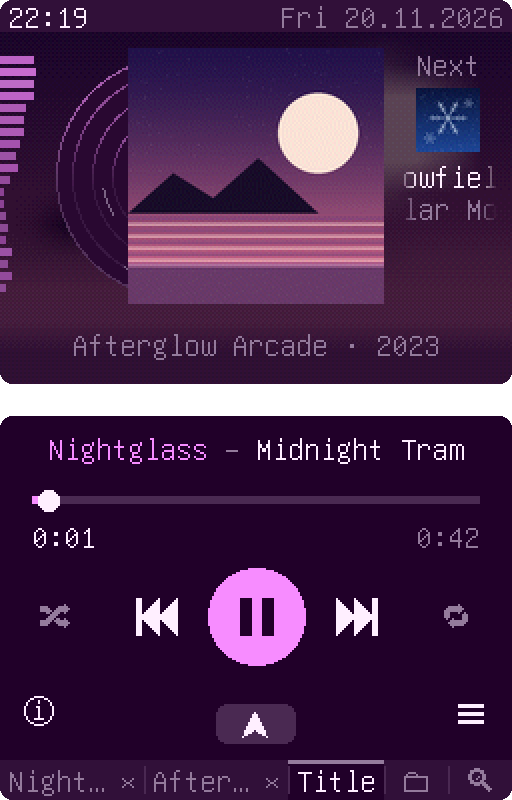

# alya-bangers
Music player for the Nintendo DS, requires a flashcart. :-)

Version 1.0, DS Edition.

<table>
<tr>
<td></td>
<td></td>
<td></td>
</tr>
</table>

*The pictures show a made-up library, the artists and songs don't exist.*

Put your music on the card with the converter on your PC, then listen to it on your DS: with covers, a turning record, search and your own colours.

> [!WARNING]
> I just wanted to listen to my music on my DS on a player I like (and looks really cool lol), so I vibecoded it... Expect a huge part of this repo to be AI generated/asssited. Like I said, I just want to enjoy my music. :-)

## Features:
- Browse your music by artist, album, song or folder
- Search by name or tag (genre, …), also in Japanese, Chinese and Russian
- A player with a turning record and a visualizer
- A queue you can change, and playlists
- An equalizer with your own profiles
- Sound settings for cleaner highs
- Rate your songs, see how often you played them
- Your own colours
- English, German and French
- A converter for Windows and Linux

## Getting started:

You need a DS or DS Lite with a flashcart (tested with the DSpico), and a PC with Windows or Linux.

1. Download the `.nds` and the converter for your PC from the [releases](../../releases).
2. Copy the `.nds` onto your flashcart's SD card.
3. Open the converter, choose your music folder and the card, then Convert.
4. Start alya-bangers from your flashcart's menu.

## More:

- [Browsing](docs/browsing.md): finding your music
- [Player](docs/player.md): playing, rating, the queue, the equalizer
- [Search](docs/search.md): searching in any language
- [Settings and themes](docs/settings.md): sound, colours, language
- [Buttons](docs/buttons.md): what every button does
- [Converter](docs/converter.md): putting your music on the card
- [FAQ](docs/faq.md): why convert first, how much fits

For the technical side:

- [How playback works](docs/how-it-works.md)
- [Development](docs/development.md): building, testing, releasing
- [Licences](docs/licences.md)

## Pre-release builds:

There are pre-release builds in [GitHub Actions](../../actions/workflows/release.yml): open the newest run, the files are at the bottom under *Artifacts* (`nds`, `converter-Windows`, `converter-Linux`). Downloading them needs a GitHub account, and they're kept for 90 days. They are less tested than a release.
If you want to build it yourself (see [Building](docs/development.md#building)).

## Licence:

© 2026 Alya (alya-can-eat). GNU GPL v3 or later (`LICENSE`). The fonts, Makefiles and the third-party code in the `.nds` are in [Licences](docs/licences.md).

This is an unofficial homebrew project. It's not affiliated with or endorsed by Nintendo. Nintendo DS and Nintendo DS Lite are trademarks of Nintendo.
