# alya-bangers

A music player for the Nintendo DS, made for the DS Lite with a DSpico. It
plays the music [dsconv](dsconv/) converts on your PC: browse by artist,
album, title or folder, search in any script, a player with a turning
record, a queue you can edit, ratings and plays, themes, in English or
German. Version 1.0 (in the making), the DS Edition.

<table>
<tr>
<td></td>
<td>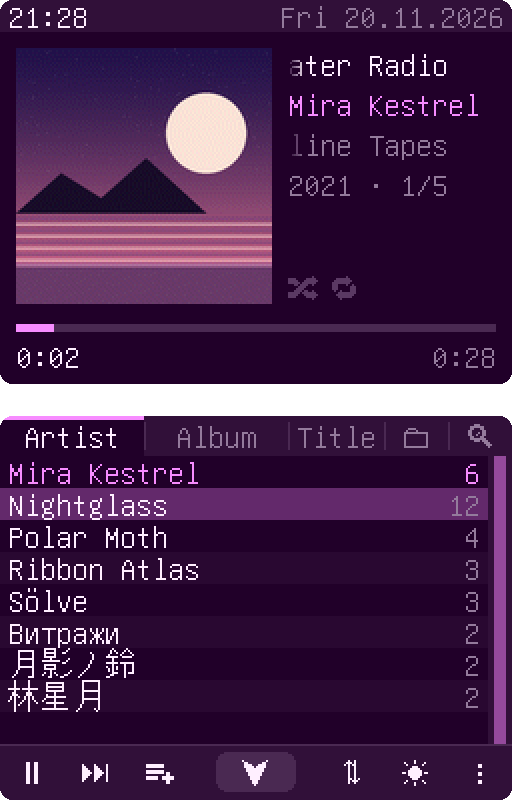</td>
<td></td>
</tr>
</table>

Both programs live in this repository: the DS program at the top, dsconv
(the PC converter) in `dsconv/`. All pictures here are the app itself,
drawn by its screen test from a made-up library.

## Browsing

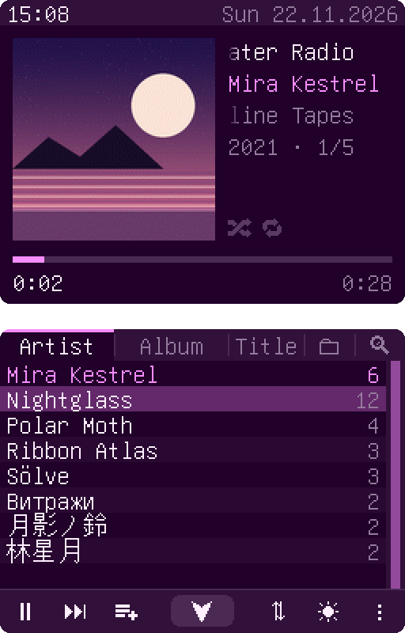

- **Tabs:** Artist · Album · Title · Folder · 🔍. Picking an artist opens
  their albums, picking an album its songs; the tabs then show your choice
  (tap the name to go back to that list, the small × clears it). Lists slide
  sideways when you switch tabs or open something, and the highlight glides
  from row to row.
- **Tapping a song** plays the list it is in. Artists that differ only in
  case ("KIVARA", "Kivara") are one artist unless you change that in the
  settings.
- **Bottom bar:** play/pause, next, add to queue, ⮟ (the player), sort,
  brightness (4 levels), ⋮ settings.
- **Add to queue:** hold a row for *Play now / Play next / Add to queue*, or
  turn on the add-to-queue button: tapping rows then adds them (an artist or
  album adds all its songs).
- **Several artists** (several values of the artist tag, as Quod Libet
  writes them) are shown together, the song is listed under each, and in the
  player each name opens its own artist. Names joined inside one value
  ("A x B") stay one artist.
- Names are drawn with the `font.bin` dsconv writes, so Japanese, Chinese,
  Cyrillic, Vietnamese and emoji show correctly.

<br clear="right">

## The player


- **⮟ in the bar:** the browser slides down until only the tabs are left.
  Seek bar (drag it), shuffle, previous, play/pause, next, repeat (off, all,
  one), ⓘ song info, ☰ queue, ⮝ back to browsing.
- **Top screen:** the cover on its record turning at 33⅓ rpm, a visualizer,
  the next song, the time and date. The background is the cover, blurred and
  darkened (made a slice per frame, faded in once the covers settle); a very
  dark cover gets a lighter one so it doesn't melt into it.
- **Song changes:** the cover slides off over its record, the next one grows
  out of the Next spot and its record rolls out; going back plays it
  backwards. In browse mode the covers behave like a stack in list order.
  The texts fade, and scroll from their start for every song. Paused, the
  record spins down and the bars of the visualizer fall.
- **The artist** at the start of the top line: tap it for their albums.
- Songs without a cover show a built-in picture, the moonlit beach.

<br clear="right">

<table>
<tr>
<td></td>
<td>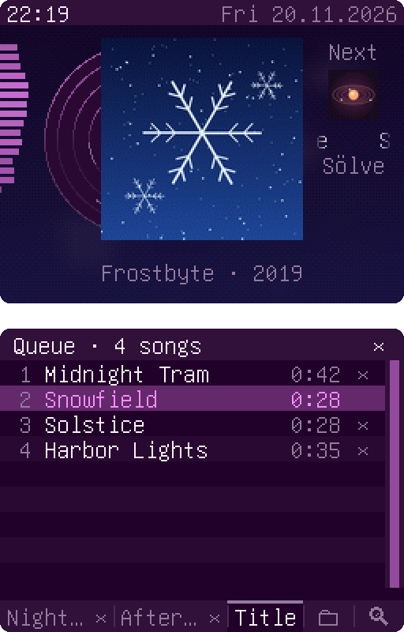</td>
<td>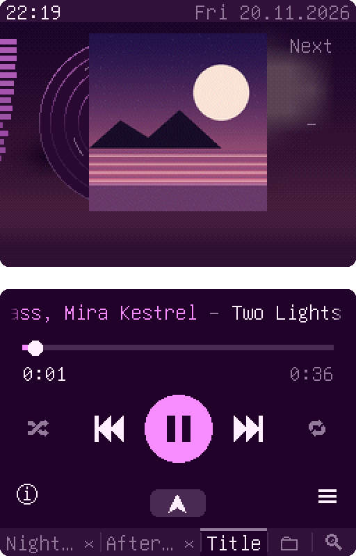</td>
</tr>
<tr>
<td align="center">ⓘ song info: rate it</td>
<td align="center">☰ the queue</td>
<td align="center">two artists, each tappable</td>
</tr>
</table>

- **Rating and plays (ⓘ):** tap a star to give the song that many (the last
  lit one again: none), or Left / Right. A song counts as played after half
  of it or 4 minutes of listening, once per listen. Your rating from the DS
  wins over the one in the file's tags; plays add up. They're kept in
  `/_nds/alya-bangers/stats.bin`.
- **Queue (☰):** tap a song to jump to it, × removes it, hold and drag to
  move it.
- **Shuffle by rating** (Settings › Player): a song's chance to come next
  doubles with every star (unrated counts as 3 stars), so 5 stars come up
  4× as often as unrated ones; a short queue still plays every song once per
  round, the good ones earlier.
- **Lid closed:** the screens fade to dark and the music keeps playing; L/R
  change songs (both can be changed in the settings).
- **Switching on** loads the last song at the same position, paused, or
  playing with *Play on launch*.

## Search

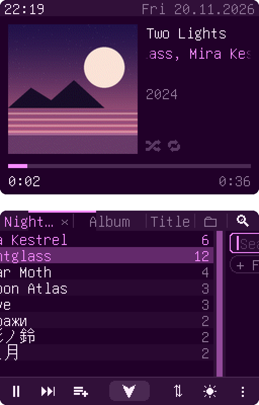

- **Type on the bottom screen**, the results show on the top screen as you
  go: artists, albums and songs, the matching part highlighted. D-pad
  Up/Down and A pick one.
- **⮟ (or B)** puts the keyboard away and the results slide down into a
  list: tap a song to play the results from it, hold one for the row menu,
  tap an artist or album to open it. Tap the query to type again, × clears
  it.
- **Matching** ignores case and accents ("solve" finds Sölve) unless you
  type the accent ("sö" means exactly ö). Hiragana finds katakana. Names
  with kanji or hanzi are found by their readings (from dsconv): kana with
  かな, pinyin with 拼音 ("lin" or "linxingyue" for 林星月).

<br clear="right">

<table>
<tr>
<td></td>
<td></td>
<td>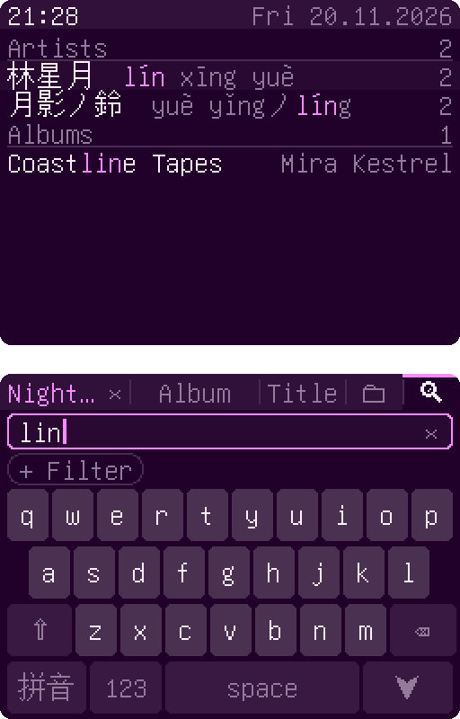</td>
</tr>
<tr>
<td align="center">hold a letter for its other forms</td>
<td align="center">かな: はな finds ハナビラ</td>
<td align="center">拼音: lin finds 林星月</td>
</tr>
<tr>
<td>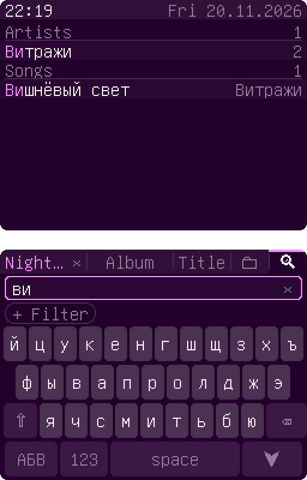</td>
<td>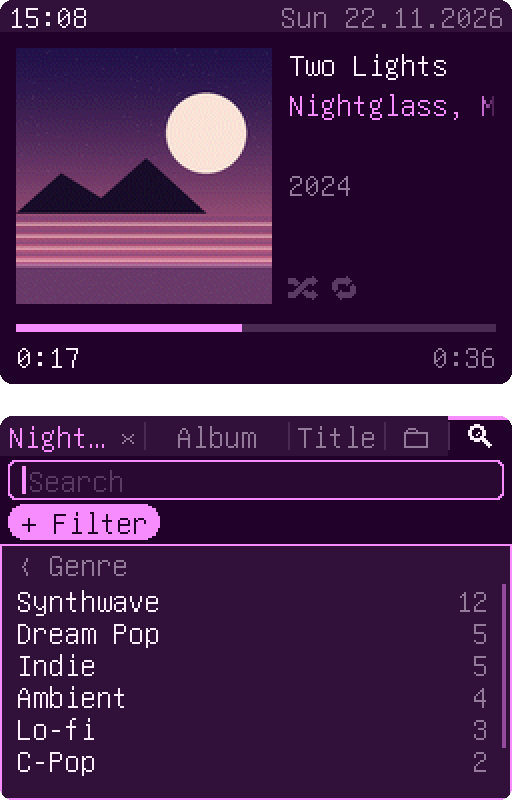</td>
<td></td>
</tr>
<tr>
<td align="center">АБВ (ЙЦУКЕН)</td>
<td align="center">+ Filter: a genre</td>
<td align="center">the filter as a chip, songs as a list</td>
</tr>
</table>

- **Keyboards:** ABC (QWERTY, or QWERTZ in Settings › Regional), かな (the
  50-sound table; ゛ ゜ and 小 change the last kana), 拼音, АБВ, and 123.
  Tap the input key for the next one (the new keys push the old ones out),
  hold it for the list. Hold a letter for its other forms (ä à á â …, е gives
  ё), slide onto one and let go.
- **+ Filter:** search in (all, only artists, only albums, only songs),
  genre, rating, year (decades), played (never, at least once, 10 times or
  more), folder, each with how many songs it has. A filter becomes a chip;
  × removes it. With a filter on, the results are songs, and what you type
  also looks at their artists and albums.

## Settings and themes

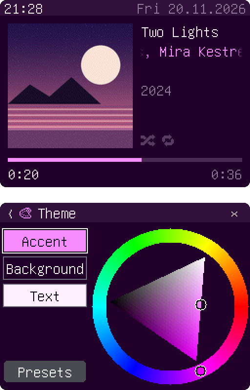

- **Settings (⋮):** pages slide in from the right (‹, B or Left go back; A
  or Right open one). Every page has an icon, so the language can be found
  without reading it: the globe (🌐) leads to Regional, then to Language.
  - *Playback:* ReplayGain, play on launch, pause when the lid closes, L/R
    skip with the lid closed
  - *Browsing:* case-sensitive names, scroll all long rows
  - *Player:* time on the right (length or time left), cover background,
    shuffle by rating
  - *Theme:* the app's three colours (accent, background, text) on a colour
    triangle: the ring chooses the hue, the triangle how strong and bright.
    Every other colour is mixed from these three, and the whole app changes
    as you drag. Up / Down choose the colour, Left / Right turn its hue.
    *Presets* (A; in fixed colours, findable with any theme): *Ultraviolet*
    (the default) and *Midnight Rose* (the first theme).
  - *Regional:* the language (English or German, German in Swiss spelling)
    and the search keyboard (QWERTY or QWERTZ)
  - *About:* name, version and edition, licence, where the code lives

<br clear="right">

<table>
<tr>
<td>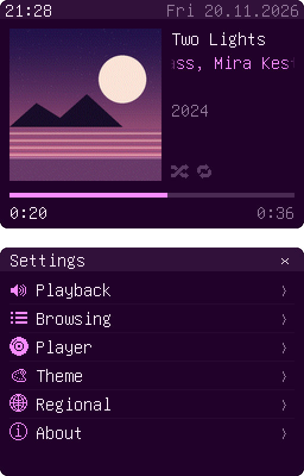</td>
<td>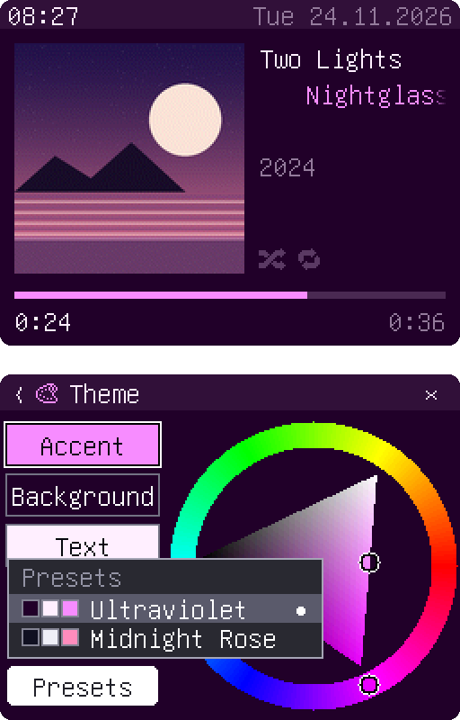</td>
<td>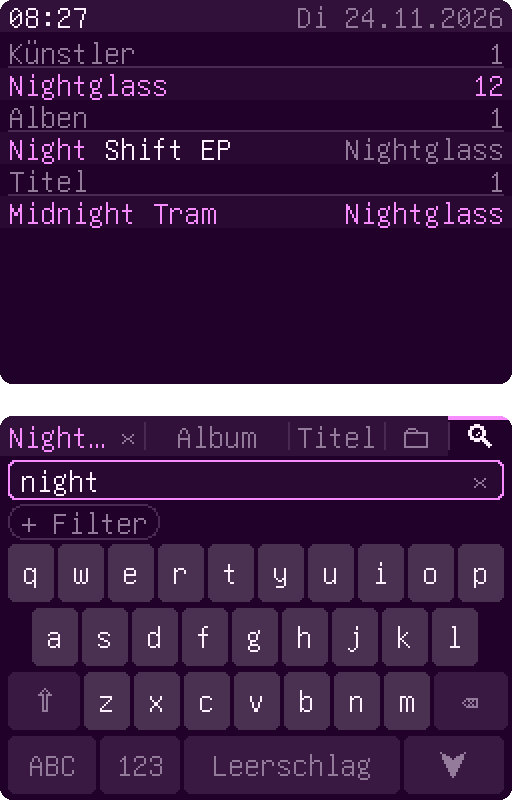</td>
</tr>
<tr>
<td align="center">settings</td>
<td align="center">theme presets</td>
<td align="center">auf Deutsch</td>
</tr>
</table>

## Buttons

| Button | Browsing | Player |
|---|---|---|
| Up / Down | move (faster when held) | |
| Left / Right | tab to the left / right | −10 s / +10 s |
| A | open / play | play / pause |
| B | the player (search: keyboard away) | back to browsing |
| X | add-to-queue mode | song info |
| Y | row menu | queue |
| SELECT | player | back to browsing |
| START | play / pause | play / pause |
| L / R | previous / next song (L restarts the song after 3 s) | same |

In menus: Up/Down, A chooses, B closes. Menus slide up when they open and
down when they close, buttons light up when tapped, play and pause morph into
each other. If the card is ever too slow, a red "drops: N" appears at the
top. Tell me if you see it on real hardware.

## The SD card

```
/music/                      <- dsconv output folder
/music/.dsmusic/font.bin
/music/.dsmusic/library.idx
/_nds/alya-bangers/state.bin <- written by the player
/_nds/alya-bangers/stats.bin <- ratings and plays from the DS
/alya-bangers.nds            <- anywhere, start it from Pico Launcher
```

```sh
dsconv ~/Music /run/media/alya/DSPICO/music
```

## Build

With the official BlocksDS container (needs Podman or Docker; on NixOS add
`virtualisation.podman.enable = true;` to your configuration):

```sh
./build.sh
```

This produces `alya-bangers.nds`. The first run downloads the image (about
430 MB).

## Test in melonDS before using the card

melonDS is in nixpkgs (`nix-shell -p melonDS`).

1. Convert some music into a test folder: `dsconv ~/Music/some-album /tmp/dscard/music`
2. In melonDS's emulator settings (DLDI section): enable DLDI, set the folder
   to sync the SD image with to `/tmp/dscard`, and turn that sync on.
3. *File → Open ROM*: `alya-bangers.nds`.

An emulator is not the real DS: timing and SD speed differ, so the final test
is always the DS Lite.

`stats.bin`: a 16-byte header (`ABST`, version 1, header size, record
count, record size), then 24-byte records sorted by key (FNV-1a 64 of the
song's path below `/music`, plays, Unix time of the last play, rating:
0 = none, 1–5 stars, 6 = rated with no stars), then a check value:
CRC-32 of the header XOR CRC-32 of the records. It's written to `stats.new` and renamed, so a save cut
short never loses the old one.

## How playback works

- The ARM9 reads the card, the ARM7 drives the sound hardware (messages in
  `common/include/ipc.h`).
- Two hardware channels (left panned left, right panned right) loop over a
  ring of 8 blocks each (1 s). The channel timer is `0x10000 - 512`, so they
  play at 16756991 / 512 = 32728.5 Hz, exactly the DS mixer's rate.
- An ARM7 timer with the /1024 prescaler ticks once per sample (same crystal,
  33513982 / 1024 Hz) and interrupts after every 4096 samples; the ARM9 then
  loads the next block into the slot that just finished. A `.dsa` block holds
  all left samples, then all right samples, so each half is read straight
  from the card into its ring.
- Playback comes before drawing: while 3 blocks or more are ready ahead, the
  ARM9 reads one block per call (twice per frame), so the reading is spread
  out; when fewer are ready, it reads all that's missing at once. The ARM7
  (and with it the sound hardware) has priority on main RAM, so copying
  whole screens can't make the sound wait.
- Pause and seek restart the stream at a block boundary (0.125 s steps).

## Tests on the PC

`tests/host` compiles the ARM9 code for the PC against a mock libnds and a
simulated ARM7 that "plays" the ring buffers:

```sh
python3 tests/card/make_test_card.py /tmp/testcard   # the test library, made up
cd tests/host
make test_player && ./test_player "/tmp/testcard/card/music/CD/Track 01.dsa"   # checks the audio sample by sample
make screens-run CARD=/tmp/testcard/card/music   # clicks through the UI, checks it, screenshots in shots/
```

The screen test expects exactly this library (its artists, albums and
counts). `make_test_card.py` needs ffmpeg and dsconv's Python dependencies;
the tests need a gcc that can build 32-bit programs (`-m32`), e.g.
`nix-shell -p gcc_multi`.

The screen test also draws every screen in German and checks that every
text exists in both languages and fits its place. All texts of the
interface are in `arm9/source/i18n.c` (English and German side by side).

The README's pictures come from a made-up library: `tests/demo/make_demo_card.py`
builds it, the screen test's demo mode (`./screens CARD out demo`) shoots the
screens and films, and `tools/gen_readme_images.py` turns them into
`docs/img/` (see the script for the three commands).

`tools/gen_builtin_font.py` regenerates the built-in glyphs (ASCII, UI
symbols, icons, the umlauts and the keyboards' letters) from dsconv's copy
of Unifont, `tools/gen_fold_tables.py` the tables search uses to ignore
accents, `tools/gen_default_cover.py`
the picture shown for songs without a cover, `tools/gen_icon.py` the
icon of the `.nds` file.

## Not yet

Playlists, genre and other tags as tabs, colours from the cover,
gapless playback, a date and time format of its own (it follows the
language), Arabic script (right to left, joined letters; Persian and Urdu
with it).

## Licence

© 2026 Alya (alya-can-eat). GNU GPL v3 or later (`LICENSE`). Built-in fallback glyphs: GNU Unifont
(GPL-2.0-or-later with the font embedding exception, see `LICENSES/`).
Makefiles: BlocksDS templates (CC0).

Code: <https://github.com/alya-can-eat>

### Third-party code in the `.nds`

Besides the code of this repository, a built `alya-bangers.nds` contains:

| Part | Licence | Notice |
|---|---|---|
| libnds (BlocksDS) | zlib | none needed in a binary |
| BlocksDS crts (start-up code, linker scripts), © 2023, 2025 Antonio Niño Díaz | Mozilla Public License 2.0 (`LICENSES/MPL-2.0.txt`) | source: <https://codeberg.org/blocksds/sdk/src/branch/master/sys/crts> |
| picolibc (the C library of the Wonderful toolchain) | BSD-style licences | all copyright notices: `LICENSES/picolibc-COPYING.txt` |
| libgcc | GPL v3 with the GCC Runtime Library Exception | none needed |
| GNU Unifont glyphs | GPL-2.0-or-later with the font embedding exception | `LICENSES/GPL-2.0.txt`, `LICENSES/Unifont-NOTICE.txt` |

Whoever publishes an `.nds` built from this code passes on `LICENSE`, the
`LICENSES/` folder and where the source is (this repository) along with it.

### Trademarks

alya-bangers is an unofficial homebrew project, not affiliated with or
endorsed by Nintendo. Nintendo DS and Nintendo DS Lite are trademarks of
Nintendo.
