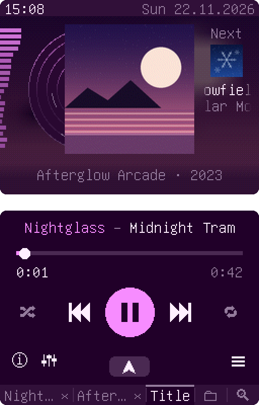
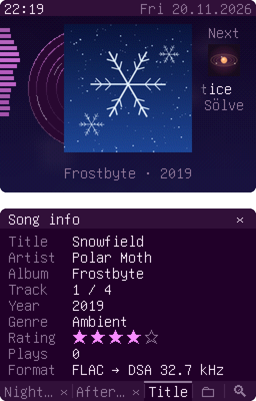
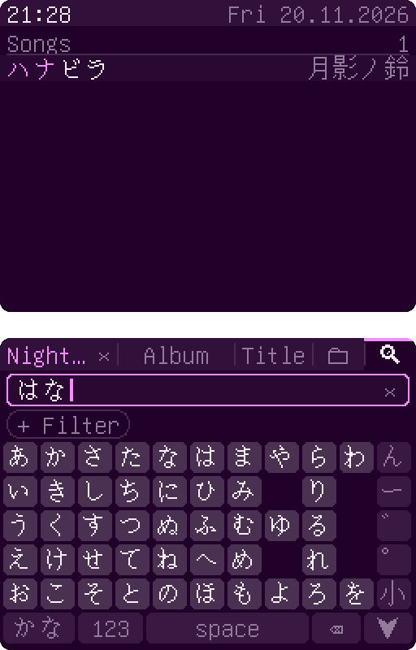
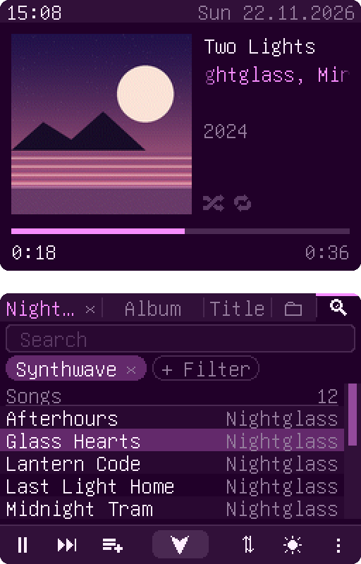

# alya-bangers
Music player for the Nintendo DS, requires a flashcart. :-)

Version 1.0 (in the making), the DS Edition.

<table>
<tr>
<td></td>
<td></td>
<td></td>
</tr>
</table>

Your music gets converted on the PC first with [dsconv](dsconv/), which is in this repo too (`dsconv/`). Everything else is the DS program.

---

> [!WARNING]
> I just wanted to listen to my music on my DS on a player I like (and looks really cool lol), so I vibecoded it... Expect a huge part of this repo to be AI generated/asssited. Like I said, I just want to enjoy my music. :-)

---

> [!NOTE]
> All pictures here are the app itself, taken by its screen test with a made-up library. The artists and songs don't exist.

## Features:
- Browse by artist, album, title or folder
- Search in any script (ABC, かな, 拼音, АБВ)
- Player with a turning record and a visualizer
- Queue you can edit
- Ratings and plays
- Themes with your own colours
- English and German

## Browsing:


- Tabs: Artist · Album · Title · Folder · 🔍
  - Picking an artist opens their albums, picking an album its songs.
  - The tabs then show what you picked. Tap the name to go back to that list, the small × clears it.
  - Lists slide sideways when you switch tabs or open something, and the highlight glides from row to row.
- Tapping a song plays the list it's in.
- Bottom bar: play/pause, next, add to queue, ⮟ (player), sort, brightness (4 levels), ⋮ settings
- Adding to the queue:
  - Hold a row for *Play now / Play next / Add to queue*
  - Or turn on the add-to-queue button. Tapping rows then adds them. (An artist or album adds all of its songs.)
- Artists that only differ in case ("KIVARA", "Kivara") are one artist. You can change that in the settings.
- Several artists (several values in the artist tag, like Quod Libet writes them):
  - Shown together, and the song is listed under each of them.
  - In the player every name opens its own artist.
  - Names joined inside one value ("A x B") stay one artist.
- Names are drawn with the `font.bin` dsconv writes, so Japanese, Chinese, Cyrillic, Vietnamese and even emoji show up correctly.

<br clear="right">

## Player:



- ⮟ in the bar: the browser slides down until only the tabs are left.
  - Seek bar (drag it), shuffle, previous, play/pause, next, repeat (off, all, one), ⓘ song info, ☰ queue, ⮝ back to browsing
- Top screen:
  - The cover on its record, turning at 33⅓ rpm
  - Visualizer, the next song, time and date
  - The background is the cover, blurred and darkened. It's made one slice per frame and fades in once the covers settle. A very dark cover gets a lighter background so it doesn't melt into it.
- When the song changes:
  - The cover slides off over its record, the next one grows out of the Next spot and its record rolls out. Going back plays it backwards.
  - In browse mode the covers behave like a stack, in list order.
  - The texts fade and scroll from their start for every song.
- Paused: the record spins down and the bars of the visualizer fall.
- Tap the artist at the start of the top line for their albums.
- Songs without a cover get a built-in picture: the moonlit beach.

<br clear="right">

<table>
<tr>
<td></td>
<td></td>
<td></td>
</tr>
<tr>
<td align="center">ⓘ song info: rate it</td>
<td align="center">☰ the queue</td>
<td align="center">two artists, each tappable</td>
</tr>
</table>

- Rating and plays (ⓘ):
  - Tap a star to give the song that many. Tap the last lit one again for none. Left / Right work too.
  - A song counts as played after half of it or 4 minutes of listening, once per listen.
  - Your rating from the DS wins over the one in the file's tags. Plays add up.
  - Saved in `/_nds/alya-bangers/stats.bin`.
- Queue (☰): tap a song to jump to it, × removes it, hold and drag to move it.
- Shuffle by rating (Settings › Player):
  - Every star doubles the chance of a song coming next (unrated counts as 3 stars). So 5 stars come up 4× as often as unrated ones.
  - A short queue still plays every song once per round, the good ones just come earlier.
- Lid closed: the screens fade to dark and the music keeps playing. L/R change songs. (Both can be changed in the settings.)
- Switching on loads the last song at the same position, paused. With *Play on launch* it keeps playing.

## Search:


- Type on the bottom screen. The results show up on the top screen while you type: artists, albums and songs, the matching part highlighted.
  - D-pad Up/Down and A pick one.
- ⮟ (or B) puts the keyboard away and the results slide down into a list:
  - Tap a song to play the results from there
  - Hold one for the row menu
  - Tap an artist or album to open it
  - Tap the query to type again, × clears it
- Matching:
  - Case and accents don't matter ("solve" finds Sölve), unless you type the accent ("sö" means exactly ö).
  - Hiragana finds katakana.
  - Names with kanji or hanzi are found by their readings (dsconv adds them): kana with かな, pinyin with 拼音 ("lin" or "linxingyue" for 林星月).

<br clear="right">

<table>
<tr>
<td></td>
<td></td>
<td></td>
</tr>
<tr>
<td align="center">hold a letter for its other forms</td>
<td align="center">かな: はな finds ハナビラ</td>
<td align="center">拼音: lin finds 林星月</td>
</tr>
<tr>
<td></td>
<td></td>
<td></td>
</tr>
<tr>
<td align="center">АБВ (ЙЦУКЕН)</td>
<td align="center">+ Filter: a genre</td>
<td align="center">the filter as a chip, songs as a list</td>
</tr>
</table>

- Keyboards: ABC (QWERTY, or QWERTZ in Settings › Regional), かな, 拼音, АБВ and 123
  - かな is the 50-sound table. ゛ ゜ and 小 change the last kana.
  - Tap the input key for the next keyboard (the new keys push the old ones out), hold it for the list.
  - Hold a letter for its other forms (ä à á â …, е gives ё), slide onto one and let go.
- \+ Filter:
  - Search in (all, only artists, only albums, only songs), genre, rating, year (decades), played (never, at least once, 10 times or more), folder
  - Every option shows how many songs it has.
  - A filter becomes a chip, × removes it.
  - With a filter on, the results are songs, and what you type also looks at their artists and albums.

## Settings and themes:


- Settings (⋮): the pages slide in from the right. ‹, B or Left go back, A or Right open one.
- Every page has an icon, so you can find the language without being able to read it: the globe (🌐) leads to Regional, then Language.
- Pages:
  - Playback: ReplayGain, play on launch, pause when the lid closes, L/R skip with the lid closed
  - Browsing: case-sensitive names, scroll all long rows
  - Player: time on the right (length or time left), cover background, shuffle by rating
  - Theme:
    - The app's three colours (accent, background, text) on a colour triangle. The ring picks the hue, the triangle how strong and bright it is.
    - Every other colour is mixed from these three, and the whole app changes while you drag.
    - Up / Down choose the colour, Left / Right turn its hue.
    - Presets (A): *Ultraviolet* (the default) and *Midnight Rose* (the first theme). They always show in their own fixed colours, so you can get back even if you made your theme unreadable xD
  - Regional: the language (English or German, the German in Swiss spelling) and the search keyboard (QWERTY or QWERTZ)
  - About: name, version and edition, licence, where the code lives

<br clear="right">

<table>
<tr>
<td></td>
<td></td>
<td></td>
</tr>
<tr>
<td align="center">settings</td>
<td align="center">theme presets</td>
<td align="center">auf Deutsch</td>
</tr>
</table>

## Buttons:

| Button | Browsing | Player |
|---|---|---|
| Up / Down | move (faster when held) | |
| Left / Right | tab to the left / right | −10 s / +10 s |
| A | open / play | play / pause |
| B | the player (search: keyboard away) | back to browsing |
| X | add-to-queue mode | song info |
| Y | row menu | queue |
| SELECT | player | back to browsing |
| START | play / pause | play / pause |
| L / R | previous / next song (L restarts the song after 3 s) | same |

- In menus: Up/Down, A chooses, B closes.
- Menus slide up when they open and down when they close, buttons light up when tapped, and play and pause morph into each other.

> [!NOTE]
> If the SD card is ever too slow, a red "drops: N" shows up at the top. If you see that on a real DS, please open an issue!

## SD card:

```
/music/                      <- dsconv output folder
/music/.dsmusic/font.bin
/music/.dsmusic/library.idx
/_nds/alya-bangers/state.bin <- written by the player
/_nds/alya-bangers/stats.bin <- ratings and plays from the DS
/alya-bangers.nds            <- anywhere, start it from Pico Launcher
```

Convert your music onto the card with dsconv:

```sh
dsconv ~/Music /run/media/alya/DSPICO/music
```

## Building:

With the official BlocksDS container. You need Podman or Docker for it.

> [!TIP]
> On NixOS add `virtualisation.podman.enable = true;` to your configuration.

```sh
./build.sh
```

This makes `alya-bangers.nds`. The first run downloads the image, which is about 430 MB.

## Testing in melonDS:

You can try it in melonDS before using the real card. melonDS is in nixpkgs (`nix-shell -p melonDS`).

1. Convert some music into a test folder: `dsconv ~/Music/some-album /tmp/dscard/music`
2. In melonDS's emulator settings (DLDI section): enable DLDI, set the folder to sync the SD image with to `/tmp/dscard` and turn that sync on.
3. *File → Open ROM*: `alya-bangers.nds`

> [!WARNING]
> An emulator is not a real DS! Timing and SD speed are different, so the final test always has to be on the DS Lite.

## How playback works:

Technical stuff, in case you're curious :-D

- The ARM9 reads the card, the ARM7 drives the sound hardware. (The messages between them are in `common/include/ipc.h`.)
- Two hardware channels (left panned left, right panned right) loop over a ring of 8 blocks each (1 s).
  - The channel timer is `0x10000 - 512`, so they play at 16756991 / 512 = 32728.5 Hz. That's exactly the DS mixer's rate.
- An ARM7 timer with the /1024 prescaler ticks once per sample (same crystal, 33513982 / 1024 Hz) and interrupts after every 4096 samples. The ARM9 then loads the next block into the slot that just finished.
  - A `.dsa` block holds all left samples, then all right samples, so each half is read straight from the card into its ring.
- Playback comes before drawing:
  - While 3 or more blocks are ready ahead, the ARM9 reads one block per call (twice per frame), so the reading is spread out.
  - When fewer are ready, it reads everything that's missing at once.
  - The ARM7 (and with it the sound hardware) has priority on main RAM, so copying whole screens can't make the sound wait.
- Pause and seek restart the stream at a block boundary (0.125 s steps).

### stats.bin:

- 16-byte header: `ABST`, version 1, header size, record count, record size
- 24-byte records, sorted by key:
  - key: FNV-1a 64 of the song's path below `/music`
  - plays
  - Unix time of the last play
  - rating: 0 = none, 1 to 5 stars, 6 = rated with no stars
- Then a check value: CRC-32 of the header XOR CRC-32 of the records.
- It's written to `stats.new` first and then renamed, so a save that gets cut short never loses the old one.

## Tests on the PC:

`tests/host` compiles the ARM9 code for the PC against a mock libnds and a simulated ARM7 that "plays" the ring buffers.

```sh
python3 tests/card/make_test_card.py /tmp/testcard   # the test library, made up
cd tests/host
make test_player && ./test_player "/tmp/testcard/card/music/CD/Track 01.dsa"   # checks the audio sample by sample
make screens-run CARD=/tmp/testcard/card/music   # clicks through the UI, checks it, screenshots in shots/
```

- The screen test expects exactly this made-up library (its artists, albums and counts).
- `make_test_card.py` needs ffmpeg and dsconv's Python dependencies.
- The tests need a gcc that can build 32-bit programs (`-m32`), e.g. `nix-shell -p gcc_multi`.
- The screen test also draws every screen in German and checks that every text exists in both languages and fits its place. All texts of the interface are in `arm9/source/i18n.c` (English and German side by side).

### Generated stuff:

- README pictures: `tests/demo/make_demo_card.py` builds the made-up library, the screen test's demo mode (`./screens CARD out demo`) shoots the screens and films, and `tools/gen_readme_images.py` turns them into `docs/img/`. (The three commands are in the script.)
- `tools/gen_builtin_font.py`: the built-in glyphs (ASCII, UI symbols, icons, the umlauts and the keyboards' letters) from dsconv's copy of Unifont
- `tools/gen_fold_tables.py`: the tables search uses to ignore accents
- `tools/gen_default_cover.py`: the picture for songs without a cover
- `tools/gen_icon.py`: the icon of the `.nds` file

## Not there yet:

- Playlists
- Genre and other tags as tabs
- Colours from the cover
- Gapless playback
- A date and time format of its own (right now it follows the language)
- Arabic script (right to left, joined letters; Persian and Urdu with it)

## Licence:

© 2026 Alya (alya-can-eat). GNU GPL v3 or later (`LICENSE`).

- Built-in fallback glyphs: GNU Unifont (GPL-2.0-or-later with the font embedding exception, see `LICENSES/`)
- Makefiles: BlocksDS templates (CC0)

Code: <https://github.com/alya-can-eat>

### Third-party code in the `.nds`:

Besides the code in this repo, a built `alya-bangers.nds` also contains this:

| Part | Licence | Notice |
|---|---|---|
| libnds (BlocksDS) | zlib | none needed in a binary |
| BlocksDS crts (start-up code, linker scripts), © 2023, 2025 Antonio Niño Díaz | Mozilla Public License 2.0 (`LICENSES/MPL-2.0.txt`) | source: <https://codeberg.org/blocksds/sdk/src/branch/master/sys/crts> |
| picolibc (the C library of the Wonderful toolchain) | BSD-style licences | all copyright notices: `LICENSES/picolibc-COPYING.txt` |
| libgcc | GPL v3 with the GCC Runtime Library Exception | none needed |
| GNU Unifont glyphs | GPL-2.0-or-later with the font embedding exception | `LICENSES/GPL-2.0.txt`, `LICENSES/Unifont-NOTICE.txt` |

If you publish an `.nds` built from this code, include `LICENSE`, the `LICENSES/` folder and where the source is (this repo) with it.

### Trademarks:

This is an unofficial homebrew project. It's not affiliated with or endorsed by Nintendo. Nintendo DS and Nintendo DS Lite are trademarks of Nintendo.
