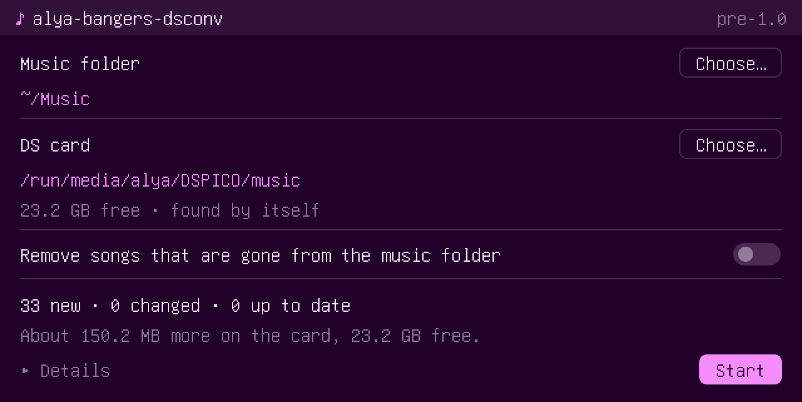

# alya-bangers-dsconv

Converts a music folder (FLAC, Opus, MP3, AAC/M4A, Vorbis, WAV, AIFF, WavPack)
into `.dsa` files that [alya-bangers](../README.md), the Nintendo DS player,
can stream straight into its sound hardware, keeping the folder structure. It also writes a library index (for
browsing by artist, album, genre or any other tag) and a font with exactly the
characters your library needs.

The formats are specified in [FORMAT.md](FORMAT.md).



Started without arguments it opens a window (music folder, DS card, Convert);
with arguments it's a command line tool. How the window works is in the
[main README](../README.md#converter).

## Run it

**Windows and Linux:** the `.exe` and the `.AppImage` from the
[releases](../../../releases). Nothing else to install.

**NixOS / Nix** (flakes enabled), from this folder:

```sh
nix run .                                              # the window
nix run . -- ~/Music /run/media/alya/DSPICO/music      # the command line
```

`nix profile install .` makes it a normal command, with an entry in the app
launcher.

**From the source**, anywhere, with [uv](https://docs.astral.sh/uv/): every
dependency comes as a prebuilt package with its native libraries included
(FFmpeg via PyAV, libsoxr, Qt via PySide6, numpy, mutagen, Pillow, and the GNU
Unifont glyphs are bundled).

```sh
uvx --from . alya-bangers-dsconv                       # the window
uvx --from . alya-bangers-dsconv ~/Music /path/to/card/music
```

(On NixOS use the Nix route; uv's prebuilt wheels need a normal Linux loader.)

## First run on the command line

```sh
alya-bangers-dsconv ~/Music /run/media/alya/DSPICO/music --dry-run
```

shows every rename and collision without writing anything. Then run it for
real without `--dry-run`. Later runs only convert new or changed files, so
just run the same command again after changing your library.

## What it does

- **Mirrors your folders.** `~/Music/Bandcamp/X/01 Song.flac` becomes
  `music/Bandcamp/X/01 Song.dsa`.
- **Converts the audio** to 16-bit PCM at 32728.5 Hz, the DS mixer's own rate,
  so the DS never resamples (high-quality soxr resampling, dithered).
  About 470 MB per hour of music. Loud masters whose peaks would clip after
  resampling are turned down just enough (their ReplayGain values are
  adjusted to match).
- **Keeps all tags** (multi-value too) under Quod Libet's key names, and
  ReplayGain values for the player to apply.
- **Readings for search:** names with kanji or hanzi get a kana reading
  (pykakasi) and a pinyin reading (pypinyin), so the DS finds 林星月 by
  "lin" and 春 by "はる". Run it again after updating and the index gets
  them; nothing is reconverted.
- **Covers:** embedded front cover first, then `cover.*` / `folder.*` /
  `front.*` / `album.*` in the folder, then the folder's only image. Disc
  subfolders (`Disc 1`, `Day Disc`, `1`, …) use the album folder's cover, so one
  `cover.jpg` next to them is enough.
  Stored ready for the DS screen (128×128 and 32×32).
- **Ignores** anything that isn't audio (Audacity projects, text files, zips…)
  and hidden files/folders, and tells you what it skipped.
- **FAT32-safe names:** `:` `*` `?` … become full-width lookalikes
  (`00：00`), a folder name can't end in a dot (`Demos...` becomes
  `Demos．．．`), reserved names get a `_`. Nothing to do by hand.
- **Collisions** (e.g. `Song.flac` and `Song.opus` in the same folder, or names
  that only differ in upper/lower case): it asks which one to keep, suggesting
  the better format (lossless > Opus > AAC/Vorbis > MP3, then bitrate). Your
  answer is remembered. `-y` takes the suggestion without asking.
- **Safe to interrupt:** Ctrl-C finishes the files in progress, saves, and the
  next run continues. Files are written to a temporary name first, so the card
  never holds half a song.

## Options

| Option | |
|---|---|
| `-n`, `--dry-run` | show what would happen, write nothing |
| `-y`, `--yes` | never ask; keep the suggested file in collisions |
| `--delete` | remove `.dsa` files whose source is gone (and folders left empty) |
| `-j N`, `--jobs N` | parallel conversions (default: all cores) |
| `--force` | reconvert everything |
| `--no-index` | skip the index and font |
| `-q`, `--quiet` | only problems and the summary |

Other commands:

```sh
alya-bangers-dsconv inspect song.dsa [--cover cover.png]   # header, tags, cover
alya-bangers-dsconv export song.dsa song.wav               # listen to the converted audio on the PC
alya-bangers-dsconv index /path/to/card/music              # rebuild index and font only
```

After each run the full report is in `<output>/.dsmusic/last-run.txt`.

## Changing the format

There is no backwards compatibility on purpose. When `FORMAT_VERSION` or
`CONVERTER_REVISION` in `src/alya_bangers_dsconv/constants.py` changes, the next run
reconverts everything automatically.

## Development

```sh
nix develop -c pytest          # or: uv run --with pytest pytest
```

The tests build a small library with the awkward cases of a real one
(colons and asterisks in names, NFD file names, case collisions, disc
subfolders, 24-bit WAV with RIFF tags, embedded vs. folder covers, CJK and
emoji titles, 5.1 audio, damaged files) and check the output down to the audio
frequencies, block layout, index and font. The window's tests click through it
offscreen: check, the question about two files, convert, stop, close while
converting, a card that's too small.

The release files:

```sh
python -m pip install ".[build]"
python packaging/build.py     # Windows: the .exe, Linux: the AppImage (needs appimagetool)
```

It packs everything with PyInstaller (`packaging/entry.py` is the start), then
tries the result: converts a short song from the command line and opens the
window offscreen for a moment. GitHub Actions does the same for both systems
(`.github/workflows/converter.yml`).

## Licence

© 2026 Alya (alya-can-eat). Code: GNU GPL v3 or later (`LICENSE`). Bundled font data: GNU Unifont,
GPL-2.0-or-later with the font embedding exception (see `LICENSES/`).

Code: <https://github.com/alya-can-eat>

alya-bangers-dsconv is part of an unofficial homebrew project, not affiliated with or
endorsed by Nintendo. Nintendo DS is a trademark of Nintendo.
