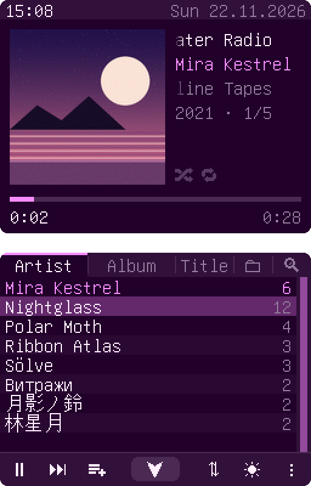
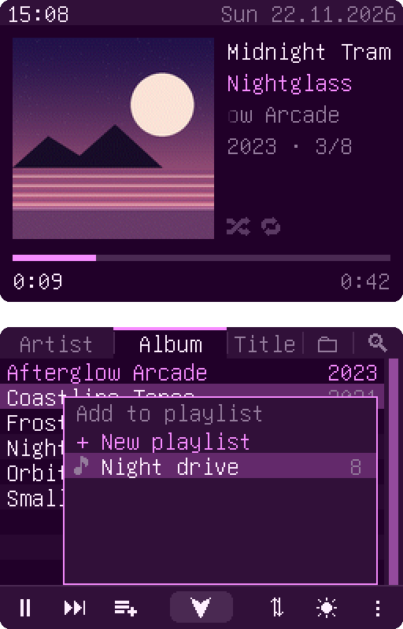
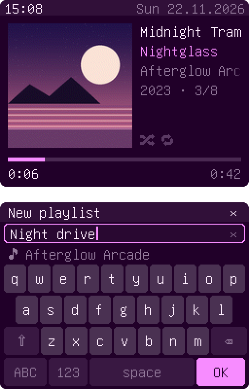
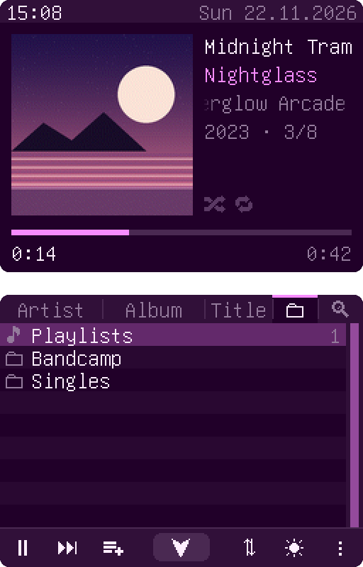
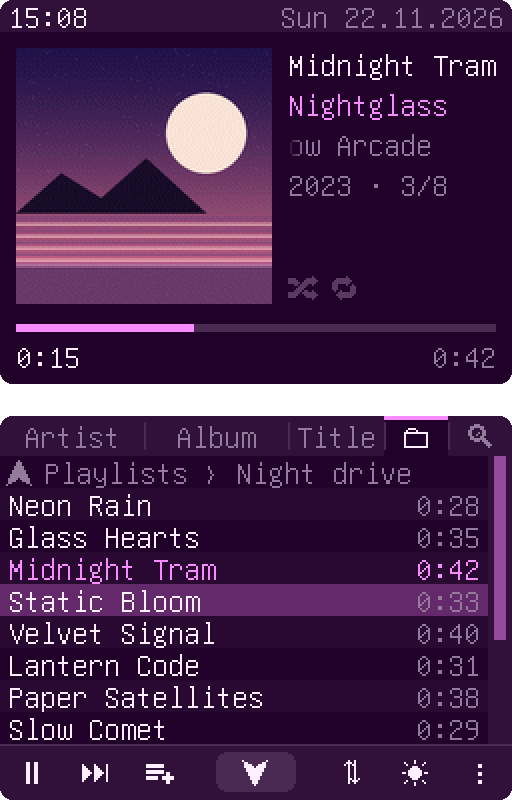

# Browsing

[‹ alya-bangers](../README.md)

Find your music by artist, album, song title or folder.

- The tabs at the top: Artist · Album · Title · Folder · 🔍 (search)
- Pick an artist to see their albums, an album to see its songs.
- Tap a song to play the list it's in.
- Hold a song for *Play now*, *Play next*, *Add to queue* or *Add to playlist*.
- Your playlists are on top of the Folder tab.
- The bar at the bottom: play/pause, next, add to queue, ⮟ the player, sort, brightness, ⋮ settings
- Japanese, Chinese, Cyrillic and Vietnamese names and even emoji show up correctly.

 

<table>
<tr>
<td></td>
<td></td>
</tr>
<tr>
<td align="center">hold a row › Add to playlist</td>
<td align="center">a new one: its name</td>
</tr>
<tr>
<td></td>
<td></td>
</tr>
<tr>
<td align="center">Playlists on top of the Folder tab</td>
<td align="center">a playlist's songs</td>
</tr>
</table>

## Details:

- Tabs:
  - The tabs then show what you picked. Tap the name to go back to that list, the small × clears it.
  - Lists slide sideways when you switch tabs or open something, and the highlight glides from row to row.
- Brightness has 4 levels.
- The add-to-queue button: turn it on, then tapping rows adds them. (An artist or album adds all of its songs.)
- Artists that only differ in case ("KIVARA", "Kivara") are one artist. You can change that in the settings.
- Several artists (several values in the artist tag, like Quod Libet writes them):
  - Shown together, and the song is listed under each of them.
  - In the player every name opens its own artist.
  - Names joined inside one value ("A x B") stay one artist.
- Names are drawn with the `font.bin` the converter writes.
- Playlists:
  - Hold a song, album, artist, folder or a tag in search › *Add to playlist* › *New playlist* or one you have. A song that's already in it isn't added twice.
  - Typing the name of one you have adds to that one.
  - The queue as a playlist: 💾 on the queue panel.
  - Folder tab › Playlists: tap one for its songs, tap a song to play the playlist from there.
  - Hold a song in a playlist › *Remove*. Hold a playlist › *Rename* or *Delete* (asks first).
  - Up to 64 playlists, 4'000 songs each.
  - Kept as `.m3u` files in `/_nds/alya-bangers/playlists/`, the songs as paths below the music folder. They stay when you convert your music again; a song that's gone stays in the file, in case it comes back.
