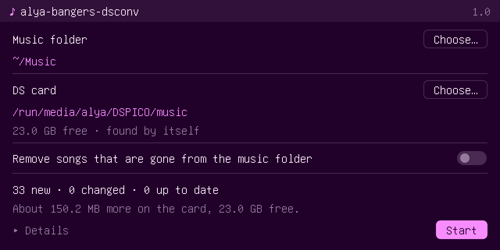
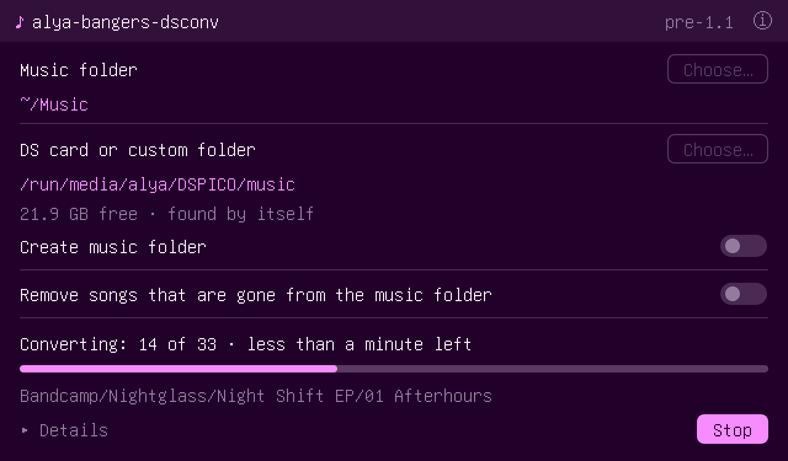

# Converter

[‹ alya-bangers](../README.md)

<table>
<tr>
<td></td>
<td></td>
</tr>
</table>

alya-bangers-dsconv puts your music on the card. Same colours and font as on the DS :-)

1. Download it from the [releases](../../../releases): the `.exe` for Windows, the `.AppImage` for Linux.
2. Double-click it.
3. Choose your music folder and the DS card.
4. Convert: it checks what's new and whether it fits. Then Start.

Next time only new and changed songs get converted.

## Details:

- The first start:
  - Windows: "Windows protected your PC" shows up, because the file isn't signed. *More info*, then *Run anyway*.
  - Linux: allow executing it first (in the file's properties, or `chmod +x`).
  - NixOS: AppImages don't run as they are there. The flake is easier: `nix run github:alya-can-eat/alya-bangers?dir=alya-bangers-dsconv`, or `nix profile install` it for an entry in the app launcher.
- Pre-release builds are in [GitHub Actions](../../../actions/workflows/release.yml).
- A card that already has music from it is found by itself.
- Two files that would become the same song (like a FLAC and an Opus of it): it asks which one goes on the card and suggests the better one. The answer is remembered.
- Playlists (`.m3u`, `.m3u8`) in your music folder go onto the card for the DS app, if the card doesn't have one with that name yet. Songs are found by their path, also in playlists made on another computer. More in [Browsing](browsing.md#details).
- *Remove songs that are gone from the music folder*: also deletes the songs on the card you don't have anymore.
- Stop finishes the songs in progress. Next time it goes on from there.
- English or German, like the computer.
- ⓘ (top right): the version, the licence and a link to this repo, like the DS app's About page.
- It also works on the command line, more in [alya-bangers-dsconv](../alya-bangers-dsconv/).

## SD card:

```
/music/                      <- what the converter writes
/music/.dsmusic/font.bin
/music/.dsmusic/library.idx
/_nds/alya-bangers/state.bin <- written by the player
/_nds/alya-bangers/stats.bin <- ratings and plays from the DS
/_nds/alya-bangers/eq.bin    <- your equalizer profiles
/alya-bangers.nds            <- anywhere, start it from Pico Launcher
```

Put your music on it with the converter (above), or on the command line:

```sh
alya-bangers-dsconv ~/Music /run/media/alya/DSPICO/music
```
