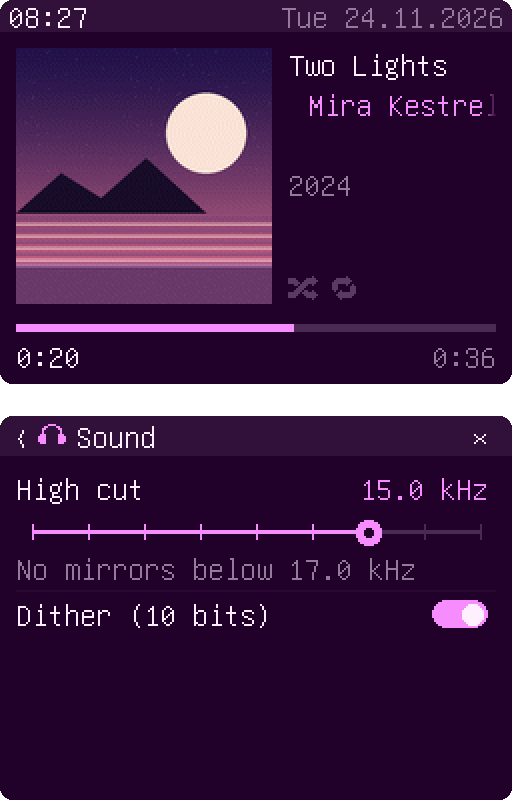

# How playback works

[‹ alya-bangers](../README.md)

Technical stuff, in case you're curious :-D

- The ARM9 reads the card, the ARM7 drives the sound hardware. (The messages between them are in `common/include/ipc.h`.)
- Two hardware channels (left panned left, right panned right) loop over a ring of 8 blocks each (1 s).
  - The channel timer is `0x10000 - 512`, so they play at 16756991 / 512 = 32728.5 Hz. That's exactly the DS mixer's rate.
- An ARM7 timer with the /1024 prescaler ticks once per sample (same crystal, 33513982 / 1024 Hz) and interrupts after every 4096 samples. The ARM9 then loads the next block into the slot that just finished.
  - A `.dsa` block holds all left samples, then all right samples, so each half is read straight from the card into its ring.
- Playback comes before drawing:
  - While 3 or more blocks are ready ahead, the ARM9 reads one block per call (twice per frame), so the reading is spread out.
  - When fewer are ready, it reads everything that's missing at once.
  - The ARM7 (and with it the sound hardware) has priority on main RAM, so copying whole screens can't make the sound wait.
- Seek restarts the stream at a block boundary (0.125 s steps).
- Pause and resume fade (15 ms each), so they don't click:
  - Pause: the ARM7 turns the channels' volume down step by step, counting samples on the same timer, then stops and reports the exact sample.
  - Resume: the stream starts at that block's beginning, silent up to that sample, and fades in from there. Nothing is heard twice.
- Equalizer:
  - Runs on the samples in the ring, in place, at most 4 blocks (0.5 s) ahead of the one playing. The reading stays up to 8 blocks ahead, so a change is heard within half a second without reading anything again.
  - Biquads (RBJ Audio EQ Cookbook) with 32-bit coefficients from `arm9/source/eq_tables.h`, samples carried with 12 extra bits, 64-bit sums.
  - The inner loop runs from ITCM in ARM mode, on a buffer in DTCM. Bands at 0 dB are skipped, so Flat costs nothing. All 3 bands take about 12 % of the ARM9 (counted from the compiled loop, not measured on the DS yet).
  - The loudest point of the curve (+0.25 dB) is worked out when a slider moves, and the input is turned down by that much.

- High cut and dither (Settings › Sound):
  - The DS plays 10 bits (PWM at 32.768 kHz, see GBATEK). The hardware just cuts off the lower 6 bits and holds every sample until the next one.
  - Holding mirrors very high sounds to 32.7 kHz minus their frequency (15 kHz also shows up at 17.7 kHz). The cut adds distortion that folds back down as tones that aren't in the music. That's the harsh sound on cymbals.
  - High cut: a 4th-order elliptic low-pass (0.1 dB ripple, at least 40 dB down), two more biquads after the bands. Its edge goes from 12.0 to 15.5 kHz in 0.5 kHz steps. What's left above the edge only mirrors above 16.8 to 18.7 kHz (the line under the slider).
  - While the high cut is on, the input is turned down 1 dB. Steep filters overshoot a bit, on loud masters about +1 dB.
  - Dither: TPDF dither and 3rd-order noise shaping round to 10 bits before the hardware does, so its cut changes nothing. The error becomes an even hiss, pushed away from around 3.5 kHz (where hearing is most sensitive) to the top.
  - On a very quiet 12 kHz tone the distortion that folds back drops from −33 dB to −54 dB with dither (`test_eq`).
  - They run in the same pass as the equalizer. High cut about 7 %, dither about 2 % of the ARM9 (counted, not measured on the DS yet). Off costs nothing.

 

### stats.bin:

- 16-byte header: `ABST`, version 1, header size, record count, record size
- 24-byte records, sorted by key:
  - key: FNV-1a 64 of the song's path below `/music`
  - plays
  - Unix time of the last play
  - rating: 0 = none, 1 to 5 stars, 6 = rated with no stars
- Then a check value: CRC-32 of the header XOR CRC-32 of the records.
- It's written to `stats.new` first and then renamed, so a save that gets cut short never loses the old one.
