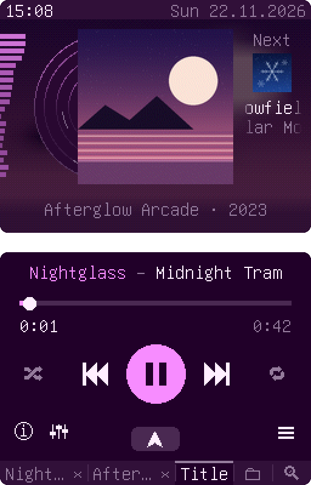
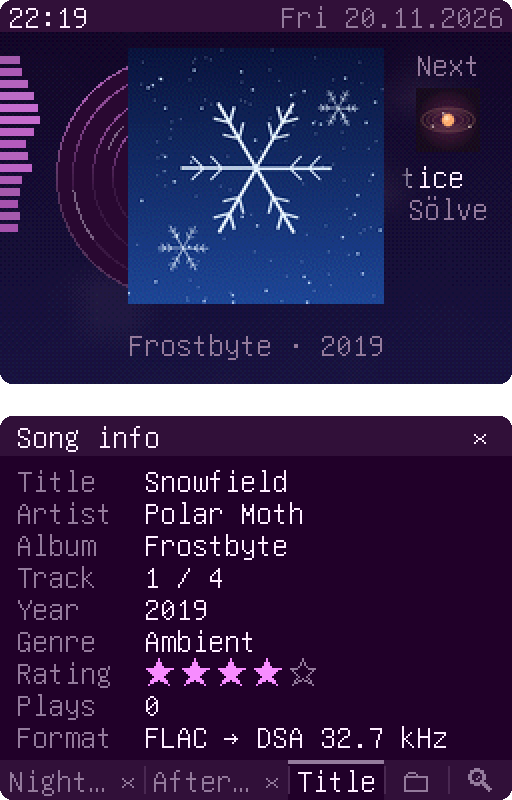
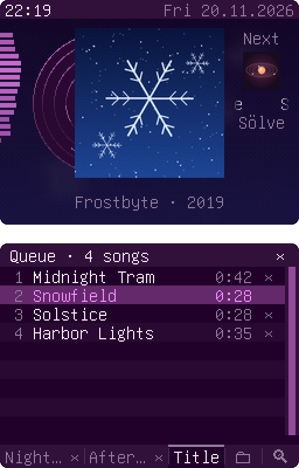
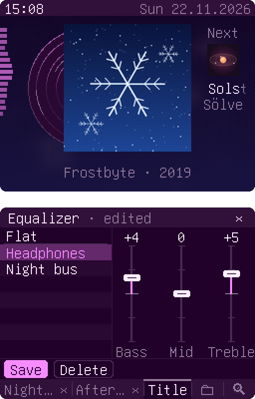
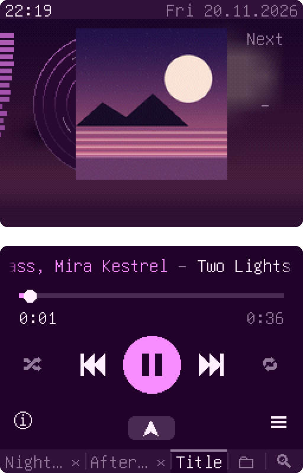

# Player

[‹ alya-bangers](../README.md)

The cover of the song on a turning record, with a visualizer.

- ⮟ in the bottom bar opens the player.
- Buttons: seek bar, shuffle, previous, play/pause, next, repeat, ⓘ song info, ☰ queue, ⮝ back to browsing
- ⓘ: give the song stars.
- ☰: the queue. Jump to a song, remove it or move it.
- The slider button next to ⓘ: the equalizer (Bass, Mid, Treble), with your own profiles.
- Close the lid and the music keeps playing. L/R change songs.
- Switched on again, it's back at the same song.

 

<table>
<tr>
<td></td>
<td></td>
</tr>
<tr>
<td align="center">ⓘ song info: rate it</td>
<td align="center">☰ the queue</td>
</tr>
<tr>
<td></td>
<td></td>
</tr>
<tr>
<td align="center">the equalizer, Treble being dragged</td>
<td align="center">two artists, each tappable</td>
</tr>
</table>

## Details:

- ⮟ in the bar: the browser slides down until only the tabs are left.
  - Seek bar (drag it), repeat (off, all, one)
- Top screen:
  - The cover on its record, turning at 33⅓ rpm
  - Visualizer, the next song, time and date
  - The background is the cover, blurred and darkened. It's made one slice per frame and fades in once the covers settle. A very dark cover gets a lighter background so it doesn't melt into it.
- When the song changes:
  - The cover slides off over its record, the next one grows out of the Next spot and its record rolls out. Going back plays it backwards.
  - In browse mode the covers behave like a stack, in list order.
  - The texts fade and scroll from their start for every song.
- Paused: the record spins down and the bars of the visualizer fall.
- Tap the artist at the start of the top line for their albums.
- Songs without a cover get a built-in picture: the moonlit beach.
- Rating and plays (ⓘ):
  - Tap a star to give the song that many. Tap the last lit one again for none. Left / Right work too.
  - A song counts as played after half of it or 4 minutes of listening, once per listen.
  - Your rating from the DS wins over the one in the file's tags. Plays add up.
  - Saved in `/_nds/alya-bangers/stats.bin`.
- Queue (☰): tap a song to jump to it, × removes it, hold and drag to move it. 💾 saves it as a playlist.
- Equalizer (the slider button next to ⓘ, lit while it changes the sound):
  - 3 bands, each −12 to +12 dB: Bass (shelf at 120 Hz), Mid (peak at 1 kHz), Treble (shelf at 5 kHz)
  - Drag a slider or tap where it should go. You hear it within half a second.
  - Tap a profile to use it. *Flat* is always on top and changes nothing.
  - Save: on one of your profiles it saves over it, on Flat it asks for a name (the search keyboard). Up to 7 profiles.
  - Hold a profile and drag it to move it. Delete asks first.
  - Boosting turns everything down by the same amount first, so nothing clips.
  - Saved in `/_nds/alya-bangers/eq.bin`, the chosen one in `state.bin`.
- Shuffle by rating (Settings › Player):
  - Every star doubles the chance of a song coming next (unrated counts as 3 stars). So 5 stars come up 4× as often as unrated ones.
  - A short queue still plays every song once per round, the good ones just come earlier.
- Lid closed: the screens fade to dark and the music keeps playing. L/R change songs. (Both can be changed in the settings.)
- Switching on loads the last song at the same position, paused. With *Play on launch* it keeps playing, fading in over 1.5 s. The screens fade in from black, like when you open the lid.
