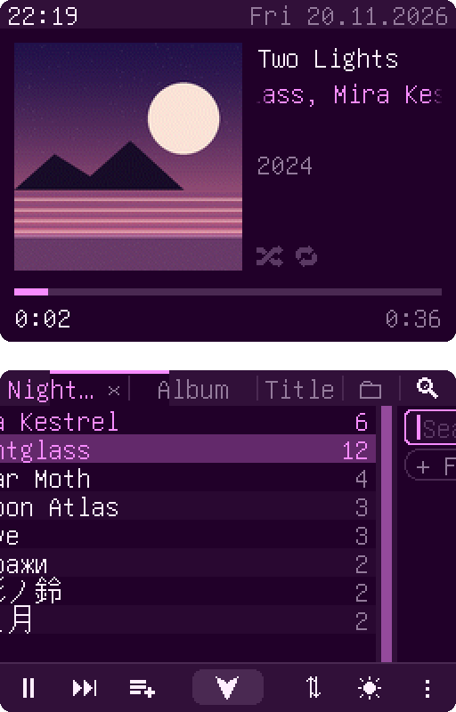
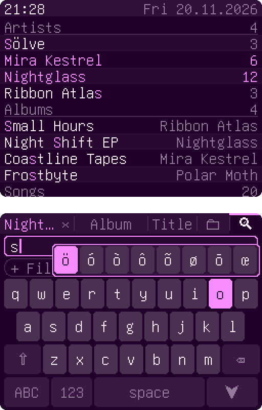
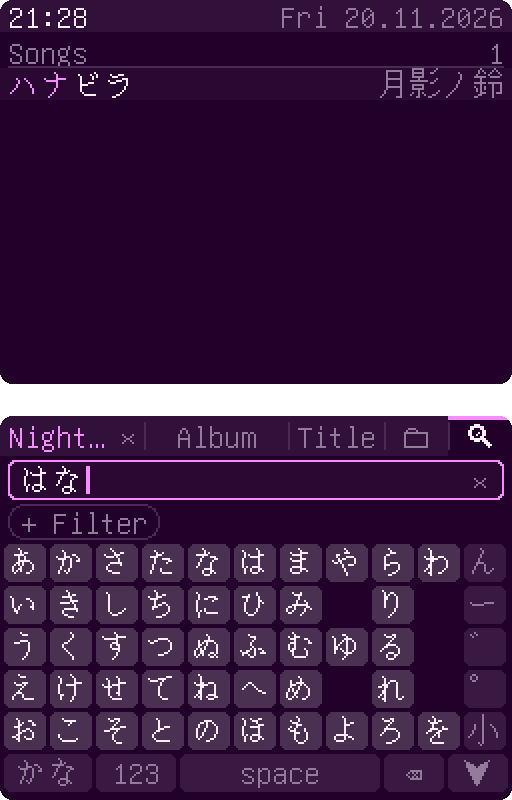
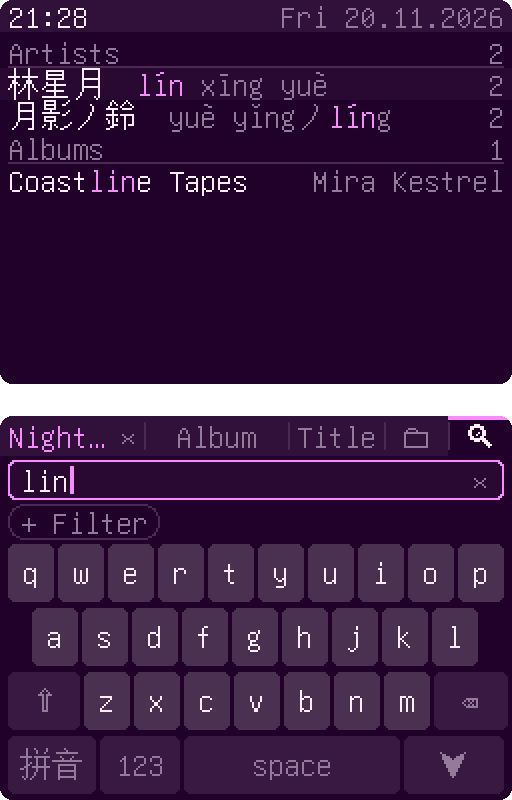
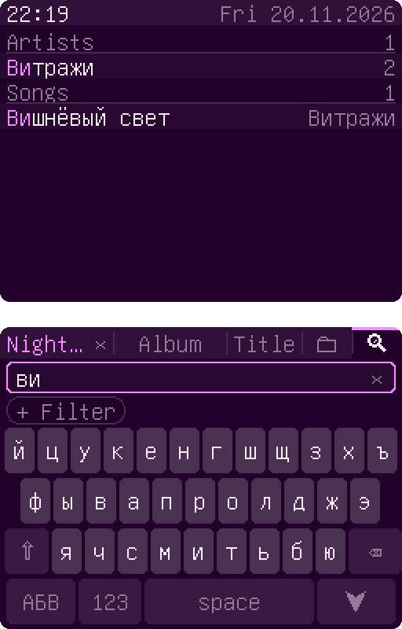
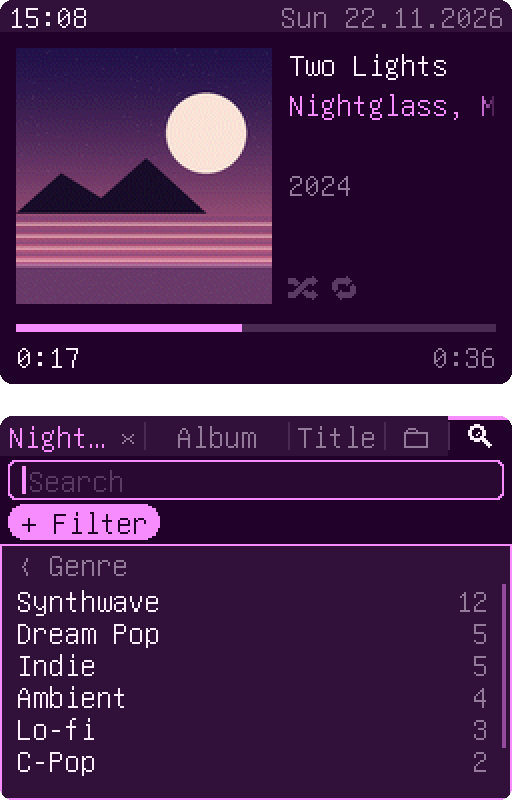
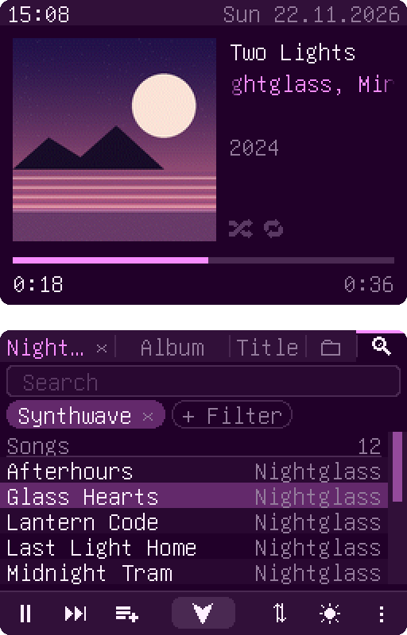

# Search

[‹ alya-bangers](../README.md)

Type on the bottom screen, and the results show up on the top screen while you type: artists, albums and songs.

- Keyboards for ABC, かな, 拼音 and АБВ
- Capital letters and accents don't matter.
- Japanese and Chinese names are also found by how they're read.
- \+ Filter narrows it down, e.g. to a genre.
- ⮟ puts the keyboard away, and the results become a list.

 

<table>
<tr>
<td></td>
<td></td>
<td></td>
</tr>
<tr>
<td align="center">hold a letter for its other forms</td>
<td align="center">かな: はな finds ハナビラ</td>
<td align="center">拼音: lin finds 林星月</td>
</tr>
<tr>
<td></td>
<td></td>
<td></td>
</tr>
<tr>
<td align="center">АБВ (ЙЦУКЕН)</td>
<td align="center">+ Filter: a genre</td>
<td align="center">the filter as a chip, songs as a list</td>
</tr>
</table>

## Details:

- The results: the matching part is highlighted. D-pad Up/Down and A pick one.
- ⮟ (or B) puts the keyboard away and the results slide down into a list:
  - Tap a song to play the results from there
  - Hold one for the row menu
  - Tap an artist or album to open it
  - Tap the query to type again, × clears it
- Matching:
  - Case and accents don't matter ("solve" finds Sölve), unless you type the accent ("sö" means exactly ö).
  - Hiragana finds katakana.
  - Names with kanji or hanzi are found by their readings (the converter adds them): kana with かな, pinyin with 拼音 ("lin" or "linxingyue" for 林星月).
- Keyboards: ABC (QWERTY, or QWERTZ in Settings › Regional), かな, 拼音, АБВ and 123
  - かな is the 50-sound table. ゛ ゜ and 小 change the last kana.
  - Tap the input key for the next keyboard (the new keys push the old ones out), hold it for the list.
  - Hold a letter for its other forms (ä à á â …, е gives ё), slide onto one and let go.
- \+ Filter:
  - Search in (all, only artists, only albums, only songs), genre, rating, year (decades), played (never, at least once, 10 times or more), folder
  - Every option shows how many songs it has.
  - A filter becomes a chip, × removes it.
  - With a filter on, the results are songs, and what you type also looks at their artists and albums.
