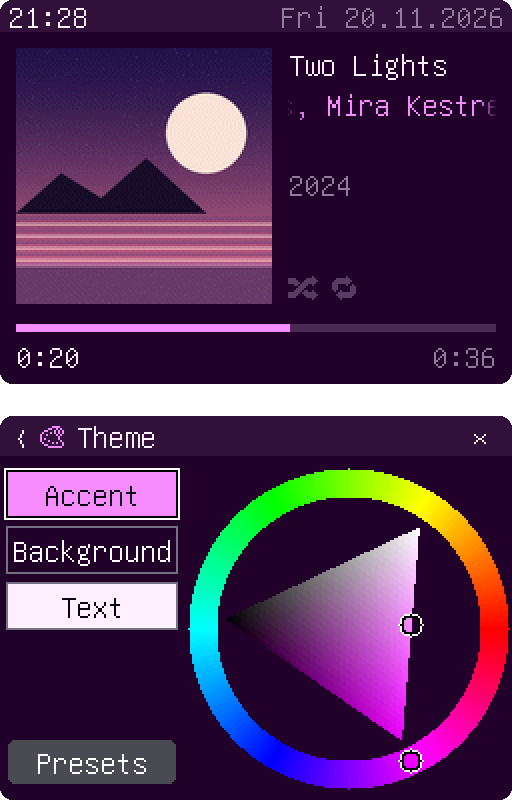
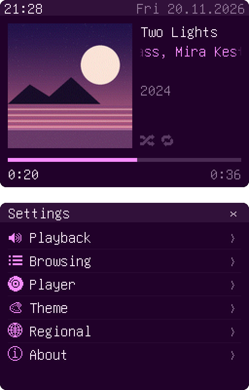
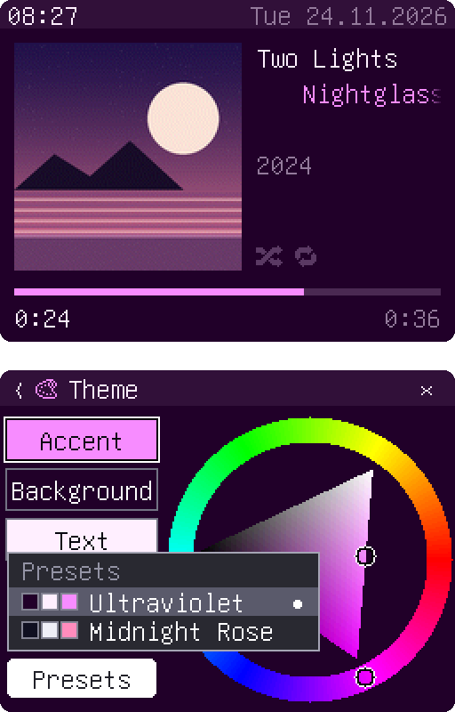
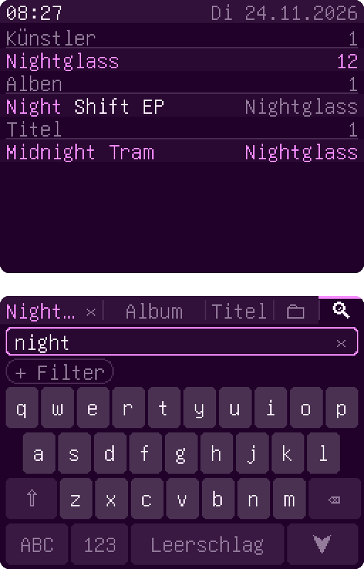

# Settings and themes

[‹ alya-bangers](../README.md)

⋮ in the bottom bar opens the settings.

- Playback: what happens when you switch on or close the lid, and a sound when the battery gets low
- Sound: two settings for very high sounds (cymbals, hi-hats) that can sound harsh on the DS
- Browsing and Player: small choices for the lists and the player
- Theme: your own colours
- Regional: English, German or French, the keyboard, the time and date format
- About: version and licence
- Misc: start another launcher from here (Pico Launcher, TWiLight Menu++, …)

The very first start asks for the language, with the DS's own one highlighted. Every page has an icon, so you can find the language without being able to read it: the globe (🌐).

 

<table>
<tr>
<td></td>
<td></td>
<td></td>
</tr>
<tr>
<td align="center">settings</td>
<td align="center">theme presets</td>
<td align="center">auf Deutsch</td>
</tr>
</table>

## Details:

- Settings (⋮): the pages slide in from the right. ‹, B or Left go back, A or Right open one. A page longer than the screen gets a scroll bar on the right, like the lists; the D-pad keeps the highlight in sight.
- The globe (🌐) leads to Regional, then Language.
- Pages:
  - Playback: ReplayGain, play on launch, pause when the lid closes, L/R skip with the lid closed, low battery sound
    - Low battery sound (on by default): when the battery gets low (the red LED), a short two-note chime plays over the music, then again every 5 minutes while it stays low. Not on the charger. A toast says it too, and 🪫 shows next to the date. Paused, the chime waits until the music plays again. Turning the setting on plays it once, so you know it.
  - Sound: for the harsh sound very high parts (cymbals, hi-hats) can get on the DS. Both off by default, try what helps with your headphones.
    - High cut: a steep filter on the very highs. The slider's right end is off, the further left the lower it cuts (15.5 down to 12.0 kHz). The line under it says below what nothing gets mirrored.
    - Dither (10 bits): the DS's rounding becomes a quiet hiss instead of a harsh edge.
    - How both work is under [How playback works](how-it-works.md).
  - Browsing: case-sensitive names, scroll all long rows, the music folder
    - Music folder: where the converted music is (`/music` if you haven't chosen one). Tap it, go to the folder, then *Use this folder*. That row is only lit where there is converted music (a `.dsmusic` folder with `library.idx` in it). The new music loads right away: what played stops, the settings close and show its artists. Each music folder has its own playlists. The folder is kept in `/_nds/alya-bangers/paths.txt`.
  - Player: time on the right (length or time left), cover background, shuffle by rating
  - Theme:
    - The app's three colours (accent, background, text) on a colour triangle. The ring picks the hue, the triangle how strong and bright it is.
    - Every other colour is mixed from these three, and the whole app changes while you drag.
    - Up / Down choose the colour, Left / Right turn its hue.
    - Presets (A): *Ultraviolet* (the default) and *Midnight Rose* (the first theme). They always show in their own fixed colours, so you can get back even if you made your theme unreadable xD
  - Regional: the language (English, German or French; the German in Swiss spelling), the search keyboard (QWERTY, QWERTZ or AZERTY), the time (24 h or 12 h with am/pm) and the date (27.11.2026, 2026-11-27 or 11/27/2026)
  - About: name, version and edition, licence, where the code lives
  - Misc: another launcher, one tap or one button away
    - Launcher: the `.nds` to start. Tap it and choose it in the file picker (folders first, then the `.nds` files; ‹ or B go up a folder, *No launcher* takes it away).
    - 🚀 in Settings (off by default): a 🚀 in the header of every settings page starts it.
    - Hold START: start it (off by default): START held for a second starts it. A short press still pauses, when you let go.
    - Starting: the music and the screens fade out, the song and its position are saved (alya-bangers plays it on from there next time), then the launcher starts.
    - It needs [Pico Loader](https://github.com/LNH-team/pico-loader) on the card in `/_pico` (`picoLoader9.bin`, `picoLoader7.bin`). The DSpico has it, other cards that Pico Loader supports can get it. Without it, a toast says so.
    - Only a `.nds` file, no flashcart menus like `_DS_MENU.DAT`. Together with alya-bangers as `_picoboot.nds` on the DSpico: the music player first, the games one hold of START away.
